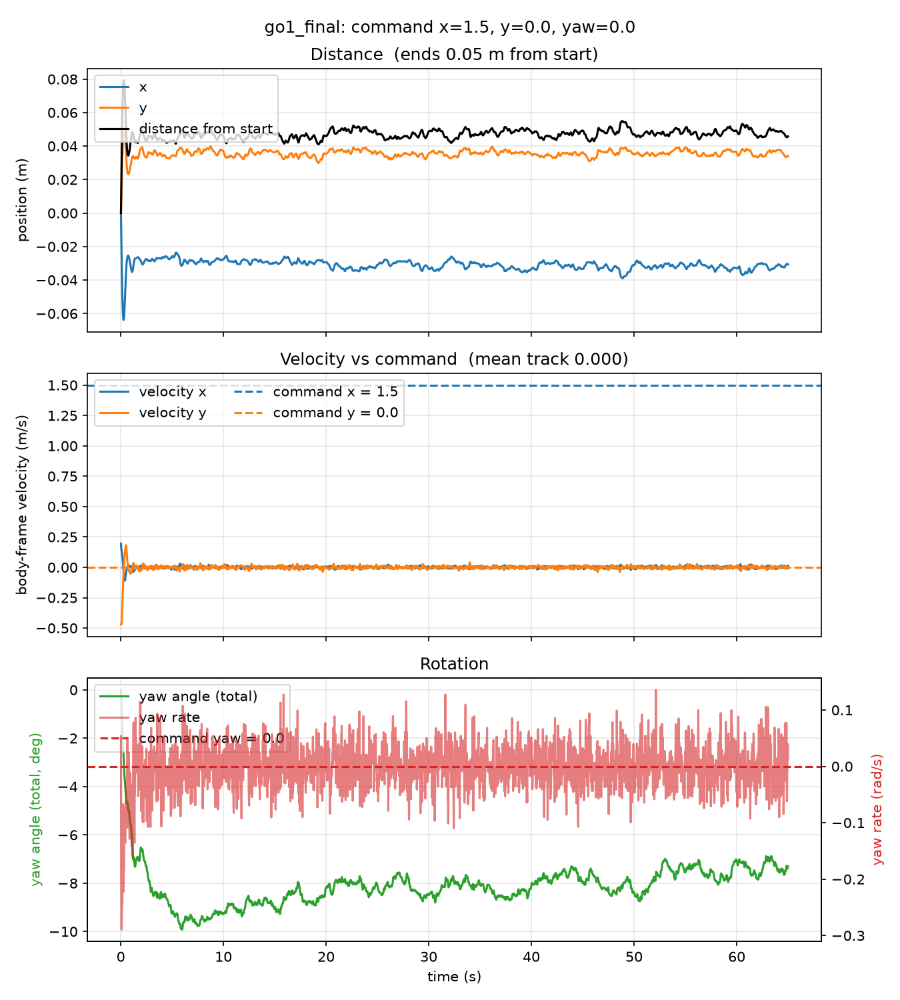
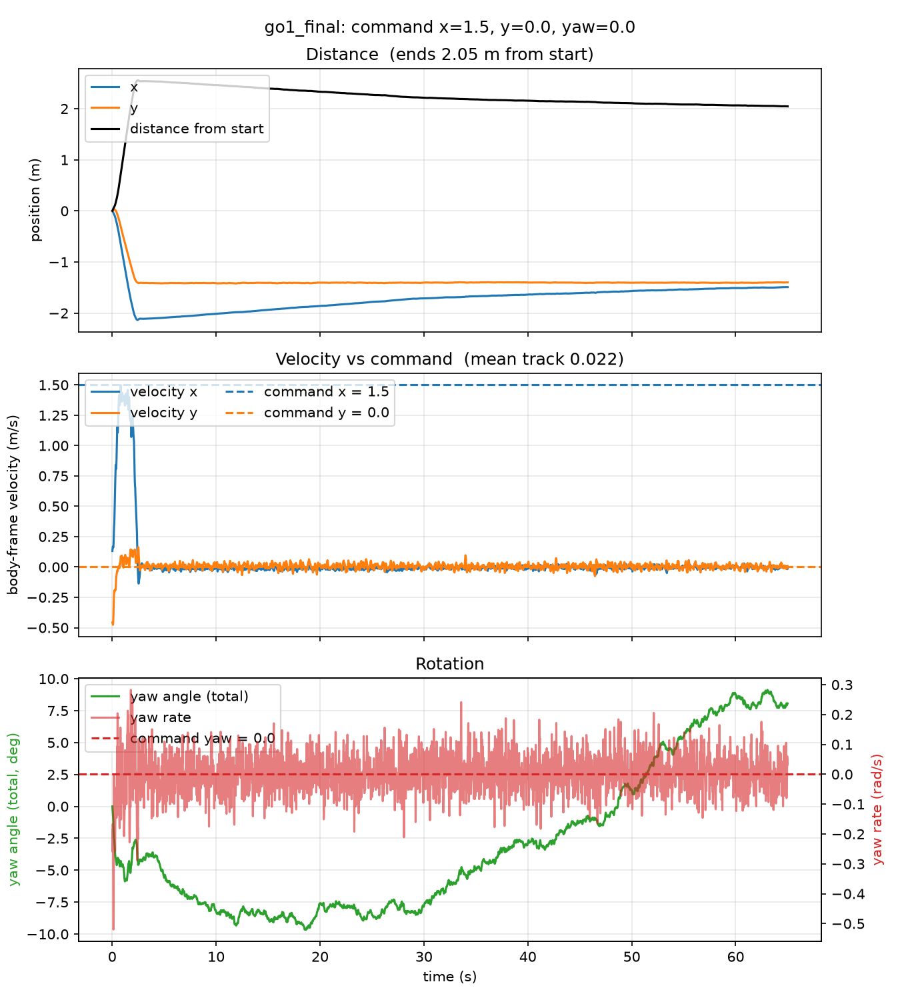

# HaiDuong

### Latest test: [Test 11](Tests/Test11/Test11.md)
**The ramp ground is moved 8 m closer, so the 15° ramp starts 2 m from the start, and a policy is trained on it (122.88M steps, about 25 minutes). It walks the flat part, climbs the 15° ramp at about 1.1 m/s, then stops at about 8.4 s, about 60% of the way up the 8 m ramp, and stands still on the slope for the rest of the 65 s. It never falls, never reaches the top of the 15° ramp and never reaches the 25° ramp. The same stop happens at commands 1.0 and 0.85, and on the old ground (23% of the way up). My hypothesis, not tested: it has settled into the same "stand still and keep the standing reward" state as my Tests 1 to 4.**

 tracking view &nbsp;·&nbsp; command x = 1.5, y = 0 &nbsp;·&nbsp; 6.5 s to 12.5 s of a 65 s run: the robot is climbing the ramp and comes to rest at about 8.4 s
 full videos: <a href="Tests/Test11/near/side_x1.5_y0.0_yaw0.0_SlopeRingsGround_2_go1_final_65s.mp4">side</a> &nbsp;·&nbsp; <a href="Tests/Test11/near/top_x1.5_y0.0_yaw0.0_SlopeRingsGround_2_go1_final_65s.mp4">top</a> &nbsp;·&nbsp; <a href="Tests/Test11/near/track_x1.5_y0.0_yaw0.0_SlopeRingsGround_2_go1_final_65s.mp4">track</a>

 distance, velocity vs command and rotation &nbsp;·&nbsp; command x = 1.5, y = 0, yaw = 0 &nbsp;·&nbsp; about 1.1 m/s forward until 8 s, then about 0 for the rest of the run

 bird's-eye trail: body centre and head tip (drawn 2 m ahead), start to end

Why it stops is not known. Other explanations I cannot rule out: a poor local optimum (standing scores about 17 to 19 per episode against 26 to 27 for walking on flat ground), a policy that finds standing safer than moving, or training episodes cut at 200 steps (4 s) that never took the robot this far. One seed, one rollout per command. Two follow-ups below.

The same series, all on the ramp ground: <a href="Tests/Test10/Test10.md">Test 10</a> (flat-trained policy, 0.85 / 0 / 0, slow and in stalls up the 15° ramp, fell on the stairs) &nbsp;·&nbsp; <a href="Tests/Test10.1/Test10.1.md">10.1</a> (2 / 2 / 0, above the trained range, fell in 1.4 s on flat ground) &nbsp;·&nbsp; <a href="Tests/Test10.2/Test10.2.md">10.2</a> (1.5 / 0.8 / 0, crossed the 15° ramp in 9 s, fell at the 25° ramp) &nbsp;·&nbsp; <a href="Tests/Test10.3/Test10.3.md">10.3</a> (trained on the ramp ground, 1.5 / 0.8 / 0, same result) &nbsp;&middot;&nbsp; <a href="Tests/Test10.4/Test10.4.md">10.4</a> (the same policy at 1.5 / 0 / 0, stalled at the foot of the 25&deg; ramp and fell at 26.3 s) &nbsp;&middot;&nbsp; <a href="Tests/Test10.5/Test10.5.md">10.5</a> (about twice the training steps, no gain)

 

### Follow-ups: Test 11.1 and Test 11.2
**Two attempts to fix the stall, and neither worked. 11.1 raised the reset interval from 200 to 1000 steps, and the policy never walked: it stood still from the first step (0.05 m in 65 s). 11.2 trained the Test 11 policy for as many steps again (245.76M in total), and it stalled earlier: it walked at about 1.2 m/s, went 0.6 m up the 15° ramp, stopped at 2.3 s and slid slowly back to the foot. Neither fell. The reward stayed at 17 to 21 in all three ramp runs (Test 11, 11.1, 11.2), against 26 to 27 on flat ground.**

<table align="center">
<tr>
<td align="center" width="400">

 <a href="Tests/Test11.1/Test11.1.md">Test 11.1</a> &nbsp;·&nbsp; reset every 1000 steps &nbsp;·&nbsp; no movement for the whole 65 s
</td>
<td align="center" width="400">

 <a href="Tests/Test11.2/Test11.2.md">Test 11.2</a> &nbsp;·&nbsp; 245.76M steps &nbsp;·&nbsp; walks 2.3 s, stops on the ramp
</td>
</tr>
</table>

videos (65 s each): 11.1 <a href="Tests/Test11.1/near/side_x1.5_y0.0_yaw0.0_SlopeRingsGround_2_go1_final_65s.mp4">side</a> &nbsp;·&nbsp; <a href="Tests/Test11.1/near/top_x1.5_y0.0_yaw0.0_SlopeRingsGround_2_go1_final_65s.mp4">top</a> &nbsp;·&nbsp; <a href="Tests/Test11.1/near/track_x1.5_y0.0_yaw0.0_SlopeRingsGround_2_go1_final_65s.mp4">track</a> &nbsp;|&nbsp; 11.2 <a href="Tests/Test11.2/near/side_x1.5_y0.0_yaw0.0_SlopeRingsGround_2_go1_final_65s.mp4">side</a> &nbsp;·&nbsp; <a href="Tests/Test11.2/near/top_x1.5_y0.0_yaw0.0_SlopeRingsGround_2_go1_final_65s.mp4">top</a> &nbsp;·&nbsp; <a href="Tests/Test11.2/near/track_x1.5_y0.0_yaw0.0_SlopeRingsGround_2_go1_final_65s.mp4">track</a>

**My theory, not tested: the policy stays still to be safe.** Moving risks falling over, and a fall ends the episode and loses all the reward the robot would still have collected. Standing still keeps a steady reward (about 17 to 21 per episode here), so a policy that has learned this may prefer standing to risking everything on a climb. That would cover both follow-ups: in 11.1 the robot never starts moving, and in 11.2 it stops once it is on the slope.

**What fits:** no run fell, every stop is smooth with the robot upright and the joints almost still, and the reward sits at the standing level. **What does not fit or is missing:** (1) in the Playground Go1 task an episode ends only when the body flips upside down (the up-axis points below horizontal), which a 15° ramp alone does not cause, so a slope is a smaller risk than "falling" suggests; (2) I did not log how often training robots fell, so I cannot say that moving was risky for them; (3) the flat-trained policies of Tests 7 and 10.2 to 10.5 crossed the 15° ramp without falling; (4) Test 11.1 never reached a slope, and it has no control (a 1000-step interval on flat ground was not run), so its standing may come from the interval alone; (5) the tilt of the body on a ramp also costs reward in this task (about -0.33 per step at 15°, my arithmetic), which could matter as well. **Other explanations I cannot rule out:** a local optimum, other reward terms, and seed-to-seed spread (11.2 used another seed for its second part). One seed each. **To test it:** log the fall rate and the reward terms in training and rollouts, run a flat-ground control with a 1000-step interval, and run more seeds of Test 11. Details: <a href="TestingAndFinding.md">TestingAndFinding.md</a>, insight 28.

 

<table align="center">
<tr>
<td align="center" width="560">
<a href="Declaration.md"><b>What I use and where it comes from</b></a>
 libraries and versions &nbsp;·&nbsp; Matplotlib, pandas &nbsp;·&nbsp; MuJoCo Playground, Brax, JAX &nbsp;·&nbsp; Go1 model &nbsp;·&nbsp; WSL2 Ubuntu &nbsp;·&nbsp; use of AI &nbsp;·&nbsp; references
</td>
</tr>
</table>

 

 the new ground: square rings around a flat middle, ramps of 15°, 25° and 35° with flat plateaus between, 100 x 100 m &nbsp;·&nbsp; a stair version of it made the robot fall at 15.2 s &nbsp;·&nbsp; written by Claude, see <a href="Declaration.md">Declaration</a>

<!-- Keep the fun fact as the last section of this README. New sections go above it. -->

> **Fun fact:** HaiDuong (Hải Dương) is my hometown in Vietnam. I have named the repo after it
> because it was windy this day and it reminds me of the autumn there.
