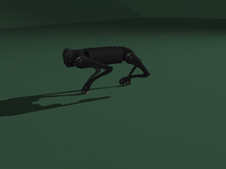
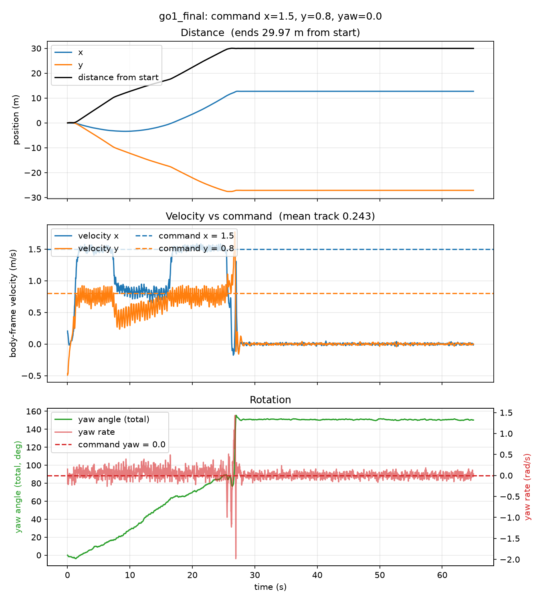
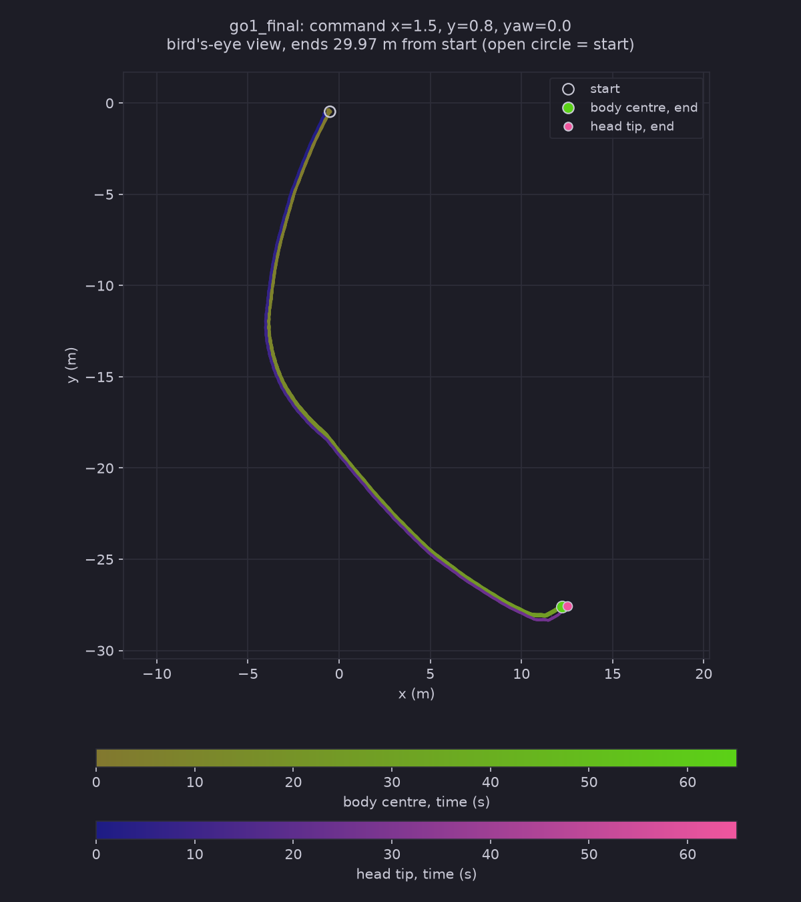

# HaiDuong

### Latest test: [Test 10.2](Tests/Test10.2/Test10.2.md)
**The Test 7 policy, trained on flat ground only, is given the biggest command it was trained on (1.5 m/s forward, 0.8 m/s sideways) and sent over the ramp rings. It crosses the 15° ramp in about 9 s (0.85 m/s in Test 10 took about 46 s), runs the plateau at full speed, then stalls at the foot of the 25° ramp and tumbles at 26.8 s. No training on slopes.**

 tracking view &nbsp;·&nbsp; command x = 1.5, y = 0.8 &nbsp;·&nbsp; 6 s to 12 s of a 65 s run: the robot reaches the foot of the ramp at about 7 s and walks up it
 full videos: <a href="Tests/Test10.2/slanted/side_x1.5_y0.8_yaw0.0_SlopeRingsGround_1_go1_final_65s.mp4">side</a> &nbsp;·&nbsp; <a href="Tests/Test10.2/slanted/top_x1.5_y0.8_yaw0.0_SlopeRingsGround_1_go1_final_65s.mp4">top</a> &nbsp;·&nbsp; <a href="Tests/Test10.2/slanted/track_x1.5_y0.8_yaw0.0_SlopeRingsGround_1_go1_final_65s.mp4">track</a>

 distance, velocity vs command and rotation &nbsp;·&nbsp; command x = 1.5, y = 0.8, yaw = 0 &nbsp;·&nbsp; speed drops on the 15° ramp (7 s to 16 s) but never stops, full speed on the plateau, then the fall at 26.8 s

 bird's-eye trail: body centre and head tip (drawn 2 m ahead), start to end

The same series: <a href="Tests/Test10/Test10.md">Test 10</a> (command 0.85 / 0 / 0, slow and in stalls up the 15° ramp, fell on the stairs) &nbsp;·&nbsp; <a href="Tests/Test10.1/Test10.1.md">Test 10.1</a> (command 2 / 2 / 0, above the trained range, fell in 1.4 s on flat ground)

 

<table align="center">
<tr>
<td align="center" width="560">
<a href="Declaration.md"><b>What I use and where it comes from</b></a>
 libraries and versions &nbsp;·&nbsp; Matplotlib, pandas &nbsp;·&nbsp; MuJoCo Playground, Brax, JAX &nbsp;·&nbsp; Go1 model &nbsp;·&nbsp; WSL2 Ubuntu &nbsp;·&nbsp; use of AI &nbsp;·&nbsp; references
</td>
</tr>
</table>

 

 the new ground: square rings around a flat middle, ramps of 15°, 25° and 35° with flat plateaus between, 100 x 100 m &nbsp;·&nbsp; a stair version of it made the robot fall at 15.2 s &nbsp;·&nbsp; written by Claude, see <a href="Declaration.md">Declaration</a>

<!-- Keep the fun fact as the last section of this README. New sections go above it. -->

> **Fun fact:** HaiDuong (Hải Dương) is my hometown in Vietnam. I have named the repo after it
> because it was windy this day and it reminds me of the autumn there.
