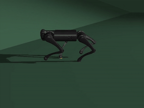

# HaiDuong

### Latest test: [Test 10](Tests/Test10/Test10.md)
**The Test 7 policy, trained on flat ground only, is sent up a 15° ramp it has never seen. At the slowest command that gets it there (0.85 m/s) it climbs slowly and in stalls, reaching the first plateau at about 63 s of a 65 s run. No training on slopes.**

 tracking view &nbsp;·&nbsp; command x = 0.85 (forward 0.85 m/s) &nbsp;·&nbsp; 13 s to 19 s of a 65 s run: the robot reaches the foot of the ramp at about 15 s and starts to climb
 full videos: <a href="Tests/Test10/slanted/side_x0.85_y0.0_yaw0.0_SlopeRingsGround_1_go1_final_65s.mp4">side</a> &nbsp;·&nbsp; <a href="Tests/Test10/slanted/top_x0.85_y0.0_yaw0.0_SlopeRingsGround_1_go1_final_65s.mp4">top</a> &nbsp;·&nbsp; <a href="Tests/Test10/slanted/track_x0.85_y0.0_yaw0.0_SlopeRingsGround_1_go1_final_65s.mp4">track</a>

 distance, velocity vs command and rotation &nbsp;·&nbsp; command x = 0.85, y = 0, yaw = 0 &nbsp;·&nbsp; 26.6 m in 65 s, about 0.2 m/s on the ramp itself

 bird's-eye trail: body centre and head tip (drawn 2 m ahead), start to end

 

<table align="center">
<tr>
<td align="center" width="560">
<a href="Declaration.md"><b>What I use and where it comes from</b></a>
 libraries and versions &nbsp;·&nbsp; Matplotlib, pandas &nbsp;·&nbsp; MuJoCo Playground, Brax, JAX &nbsp;·&nbsp; Go1 model &nbsp;·&nbsp; WSL2 Ubuntu &nbsp;·&nbsp; use of AI &nbsp;·&nbsp; references
</td>
</tr>
</table>

 

 the new ground: square rings around a flat middle, ramps of 15°, 25° and 35° with flat plateaus between, 100 x 100 m &nbsp;·&nbsp; a stair version of it made the robot fall at 15.2 s &nbsp;·&nbsp; written by Claude, see <a href="Declaration.md">Declaration</a>

<!-- Keep the fun fact as the last section of this README. New sections go above it. -->

> **Fun fact:** HaiDuong (Hải Dương) is my hometown in Vietnam. I have named the repo after it
> because it was windy this day and it reminds me of the autumn there.
