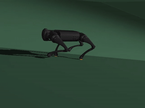
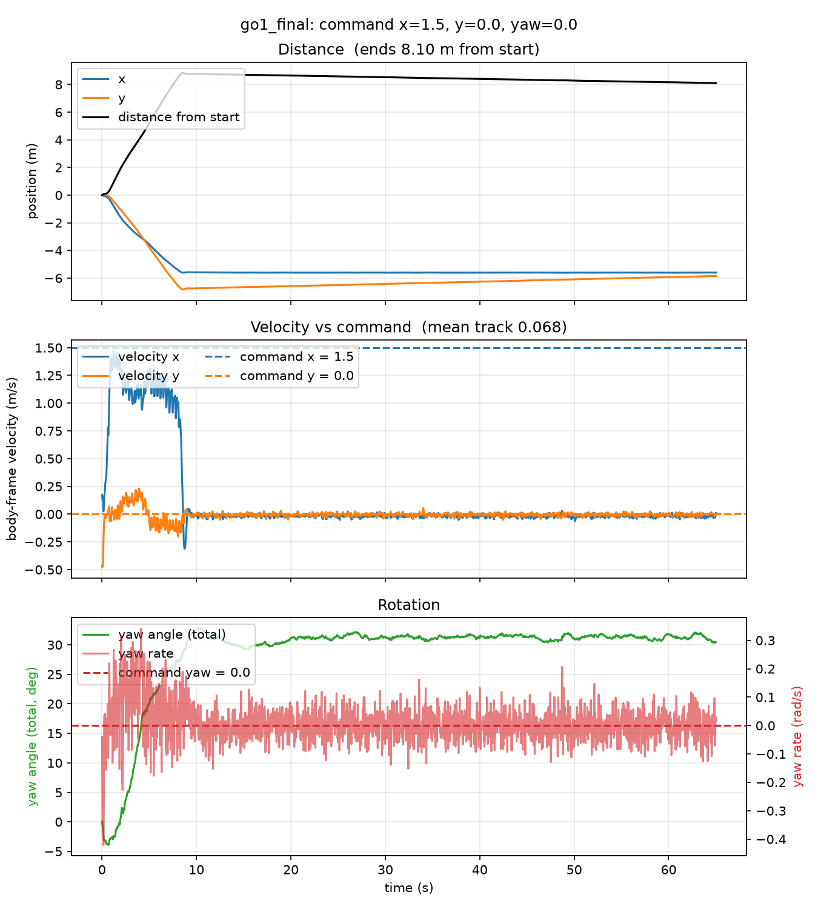
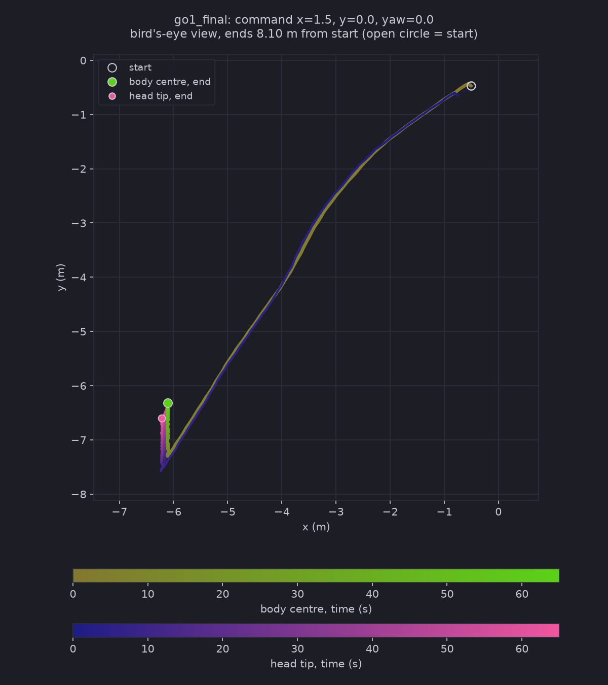
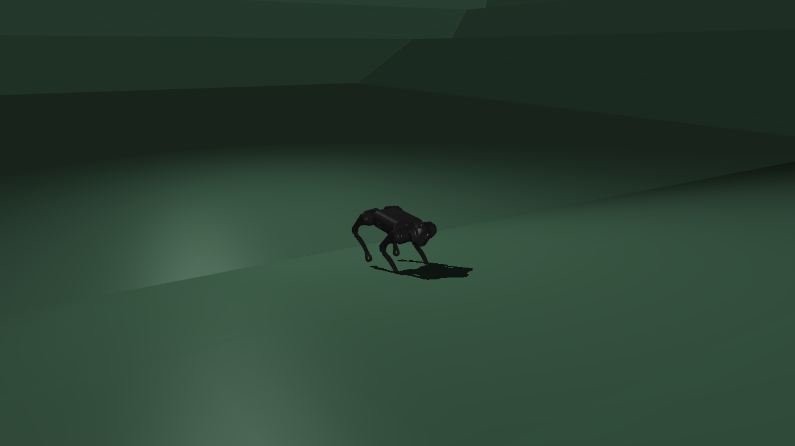

# HaiDuong

### Latest test: [Test 11](Tests/Test11/Test11.md)
**The ramp ground is moved 8 m closer, so the 15° ramp starts 2 m from the start, and a policy is trained on it (122.88M steps, about 25 minutes). It walks the flat part, climbs the 15° ramp at about 1.1 m/s, then stops at about 8.4 s and stands still on the slope for the rest of the 65 s. It never falls and never reaches the 25° ramp. My hypothesis, not tested: it has settled into the same "stand still and keep the standing reward" state as my Tests 1 to 4.**

 tracking view &nbsp;·&nbsp; command x = 1.5, y = 0 &nbsp;·&nbsp; 6.5 s to 12.5 s of a 65 s run: the robot is climbing the ramp and comes to rest at about 8.4 s
 full videos: <a href="Tests/Test11/near/side_x1.5_y0.0_yaw0.0_SlopeRingsGround_2_go1_final_65s.mp4">side</a> &nbsp;·&nbsp; <a href="Tests/Test11/near/top_x1.5_y0.0_yaw0.0_SlopeRingsGround_2_go1_final_65s.mp4">top</a> &nbsp;·&nbsp; <a href="Tests/Test11/near/track_x1.5_y0.0_yaw0.0_SlopeRingsGround_2_go1_final_65s.mp4">track</a>

 distance, velocity vs command and rotation &nbsp;·&nbsp; command x = 1.5, y = 0, yaw = 0 &nbsp;·&nbsp; about 1.1 m/s forward until 8 s, then about 0 for the rest of the run

 bird's-eye trail: body centre and head tip (drawn 2 m ahead), start to end

The same series, all on the ramp ground: <a href="Tests/Test10/Test10.md">Test 10</a> (flat-trained policy, 0.85 / 0 / 0, slow and in stalls up the 15° ramp, fell on the stairs) &nbsp;·&nbsp; <a href="Tests/Test10.1/Test10.1.md">10.1</a> (2 / 2 / 0, above the trained range, fell in 1.4 s on flat ground) &nbsp;·&nbsp; <a href="Tests/Test10.2/Test10.2.md">10.2</a> (1.5 / 0.8 / 0, crossed the 15° ramp in 9 s, fell at the 25° ramp) &nbsp;·&nbsp; <a href="Tests/Test10.3/Test10.3.md">10.3</a> (trained on the ramp ground, 1.5 / 0.8 / 0, same result) &nbsp;&middot;&nbsp; <a href="Tests/Test10.4/Test10.4.md">10.4</a> (the same policy at 1.5 / 0 / 0, stalled at the foot of the 25&deg; ramp and fell at 26.3 s) &nbsp;&middot;&nbsp; <a href="Tests/Test10.5/Test10.5.md">10.5</a> (about twice the training steps, no gain)

 

<table align="center">
<tr>
<td align="center" width="560">
<a href="Declaration.md"><b>What I use and where it comes from</b></a>
 libraries and versions &nbsp;·&nbsp; Matplotlib, pandas &nbsp;·&nbsp; MuJoCo Playground, Brax, JAX &nbsp;·&nbsp; Go1 model &nbsp;·&nbsp; WSL2 Ubuntu &nbsp;·&nbsp; use of AI &nbsp;·&nbsp; references
</td>
</tr>
</table>

 

 the new ground: square rings around a flat middle, ramps of 15°, 25° and 35° with flat plateaus between, 100 x 100 m &nbsp;·&nbsp; a stair version of it made the robot fall at 15.2 s &nbsp;·&nbsp; written by Claude, see <a href="Declaration.md">Declaration</a>

<!-- Keep the fun fact as the last section of this README. New sections go above it. -->

> **Fun fact:** HaiDuong (Hải Dương) is my hometown in Vietnam. I have named the repo after it
> because it was windy this day and it reminds me of the autumn there.
