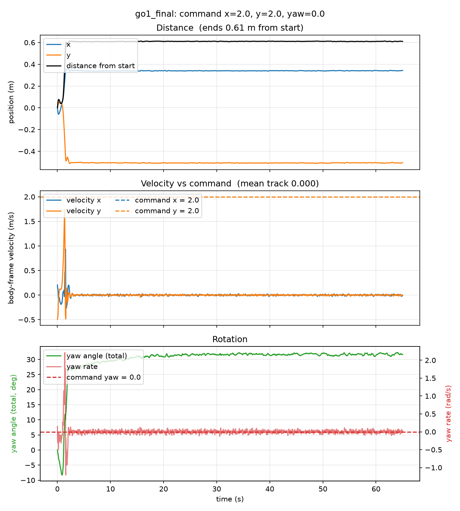
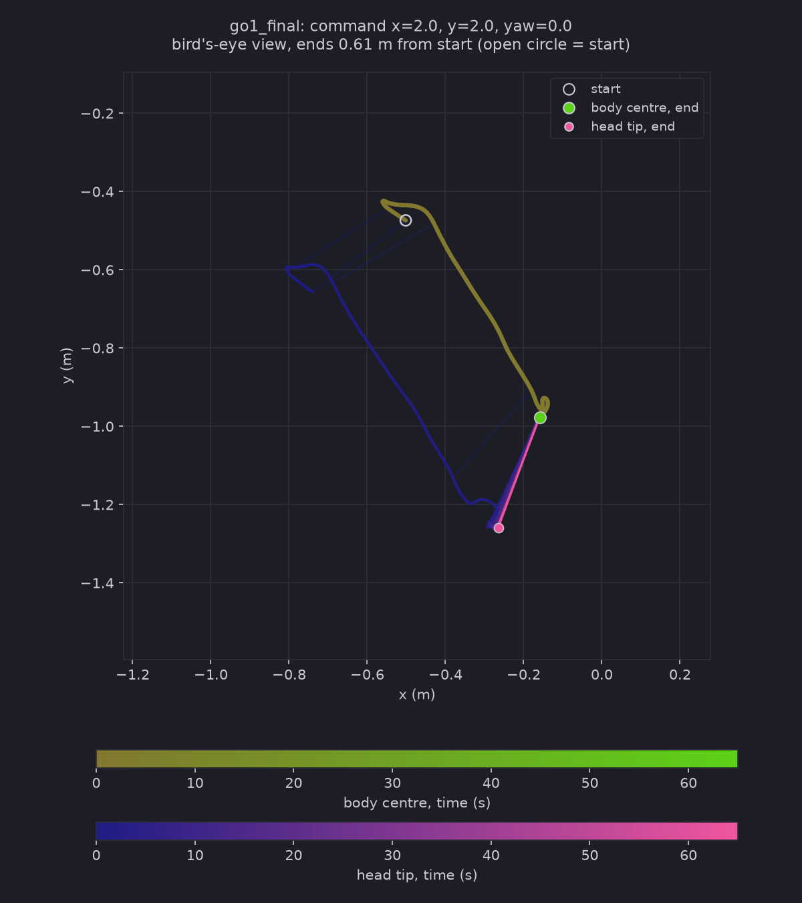

# Test Log 10.1 — Test 10 on the ramp ground with command 2 / 2 / 0 (Test 7 policy, no new training)

**Date:** 2026-11-07
**Result:** Fail, and it never reached the ramp. With the command at x = 2 and y = 2 (both above the trained range), the robot did not walk. It shook in place for about a second, tipped sideways at about 1.0 s, and the episode was terminated at step 69 (1.4 s) on the flat middle, 0.61 m from the start. It lay on its back for the other 63.6 s (`track` 0.0000). One run.

**Purpose:** Repeat [Test 10](../Test10/Test10.md) on the ramp ground only, with the same policy, start, length and cameras, but with the command raised from 0.85 / 0 / 0 to **2 / 2 / 0**, to see what the policy does when both the forward and the sideways command are above what it was trained on (trained range x 1.5, y 0.8, yaw 1.2; `command_config.a = [1.5, 0.8, 1.2]`).

## Conditions (same as Test 10 except the command)

| Setting | Value |
|---|---|
| Policy | Test 7, checkpoint `go1_final` (122,880,000 steps, flat ground), folder `~/go1_test8/go1_final` |
| Robot | `go1_mjx_feetonly.xml` (only the feet collide with the ground), no hat |
| Ground | `SlopeRingsGround_1` (the ramp rings: flat to d = 10 m, 15° ramp to 18 m, and so on) |
| Command (x / y / yaw) | **2 / 2 / 0**, held for the whole run (Test 10: 0.85 / 0 / 0) |
| Length | 65 s = 3,250 steps (1 step = 0.02 s) |
| Start | Middle of the terrain, flat, z = 0, `PRNGKey(0)` |
| Rollout, videos | `Scripts/rollout_terrain.py`, then `Scripts/render_qpos.py` (`top`, `side`, `track`), as in Test 10 |
| Run script | [run_test10_1.sh](./run_test10_1.sh), progress in `~/test10_1_progress.txt` |
| Hardware | NVIDIA GeForce RTX 5060 Laptop (8 GB), WSL2 Ubuntu 24.04, plugged in |

Files are in `slanted/`: the motion data (`.npz`), `motion_*.png`, `trail_*.png`, `rollout_out.txt` and the three videos.

## Results

I checked the `track` video by frames (every third video frame for the first 1.9 s, then one frame every 8 s) and read the motion graph, the trail map and the rollout numbers. The `top` and `side` videos were not watched.

| | Test 10 slanted (0.85 / 0 / 0) | Test 10.1 (2 / 2 / 0) |
|---|---|---|
| Fell (episode terminated) | no | **yes, at step 69 (1.4 s)** |
| Mean `track` over 65 s | 0.483 | **0.0000** |
| Distance from start | 26.64 m | **0.61 m** |
| Reached the first ring (d = 10 m) | 14.7 s | never (it stayed within 1 m of the start) |
| Upright (1 = level) | min 0.970 | min -0.996, -0.981 at the end |
| Body height | up to 2.47 m (plateau) | min -0.329 m, mean -0.242 m |

- **0 to about 1 s:** it never accelerates. Body speed stays between about -0.17 and +0.16 m/s against a command of 2 / 2, and it drifts 5 to 15 cm. The track frames show it standing with its legs working (rocking and shuffling), not trotting.
- **About 1.0 to 1.4 s:** it tips sideways. Upright goes from 0.93 (1.0 s) to 0.81 (1.2 s) to -0.12 (1.38 s). Sideways speed spikes to about 1.7 m/s and roll rate to about 10 rad/s during the roll, which is the fall, not walking. The heading turns by about +32° in total.
- **From 1.6 s to 65 s:** nothing moves. It lies on its back (upright -0.98), at (-0.16, -0.98), with the body about 0.25 m below the start level. In the track video you only see the four foot spheres and a leg or two against the ground for the whole rest of the run, unchanged at 8 s intervals. The same thing happened in Test 10 on the stairs, and my reading is the same (feet-only collision, so the trunk sinks into the ground; not tested).
- **The ramp played no part.** It fell about 0.9 m from the start, on flat ground, so this run says nothing about the ramp at this command.

## Takeaways

1. **A command well above the trained range (x 2 against 1.5, y 2 against 0.8) does not make the policy go faster. It makes it fall over on flat ground within 1.4 s.** In Test 7 it followed y = -1, which is only 0.2 above its range, so the failure point is somewhere between that and this run.
2. **I cannot say which of the two inputs causes it.** Both were out of range at once. x = 2 with y = 0, or x = 1.5 with y = 2, would split them (not run).
3. **The ramp still has to be tested with a command it can walk.** Test 10 used 0.85 / 0 / 0, which is the slowest that gets up. A faster in-range command would show whether more speed helps on the 15° ramp. That became [Test 10.2](../Test10.2/Test10.2.md) (1.5 / 0.8 / 0): it crosses the 15° ramp in about 9 s and falls at the foot of the 25° ramp. In the Test 10 climb search, 1.3 and 1.5 fell at 78 s and 31 s.

## Caveats

- One policy, one seed, one start, one run. I do not know if a different start would also fall.
- The track video was checked by frames, not frame by frame, and `top` and `side` were not watched.
- Contact points in the videos are recomputed on the CPU, so they can differ slightly from the GPU simulation.
- The run script was written by Claude from my command (to go in Declaration.md).
