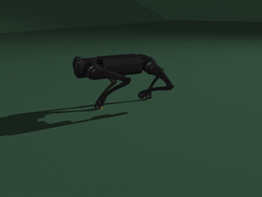
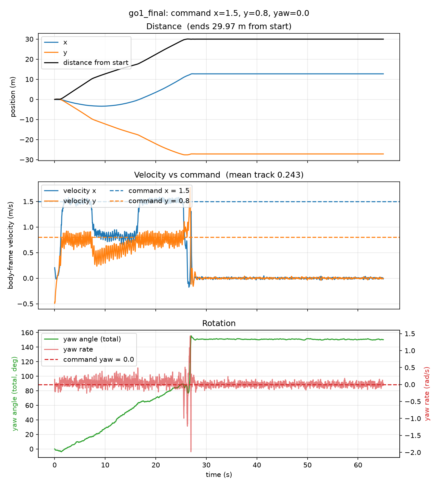
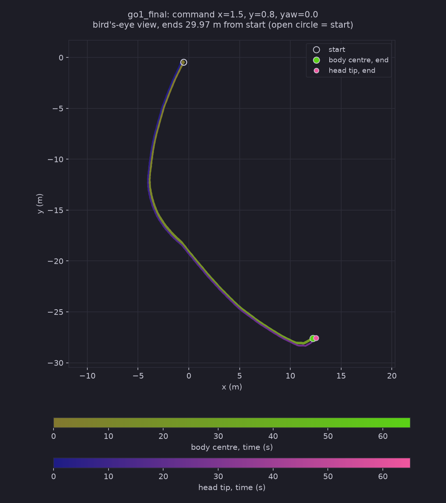

# Test Log 10.2 — Test 10 on the ramp ground with command 1.5 / 0.8 / 0, the edge of the trained range (Test 7 policy, no new training)

**Date:** 2026-11-07
**Result:** The policy follows the command at the edge of its range and climbs the first 15° ramp in about 9 s (Test 10 at 0.85 / 0 / 0: about 46 s). It then crosses the plateau at full speed, but stalls at the foot of the 25° ramp (25.5 s), tumbles at 26.8 s (episode terminated at step 1340) and lies on its back for the remaining 38 s. `track` is 0.243 over the 65 s (0.607 over the first 25 s). One run.

**Purpose:** [Test 10.1](../Test10.1/Test10.1.md) (command 2 / 2 / 0, above the range) fell on flat ground in 1.4 s. To separate "too fast" from "out of range", repeat it with the largest command the policy was trained on: x = 1.5 and y = 0.8 (`command_config.a = [1.5, 0.8, 1.2]` in Playground's `go1/joystick.py`; yaw stays 0).

## Conditions (same as Test 10 and 10.1 except the command)

| Setting | Value |
|---|---|
| Policy | Test 7, checkpoint `go1_final` (122,880,000 steps, flat ground), folder `~/go1_test8/go1_final` |
| Robot | `go1_mjx_feetonly.xml` (only the feet collide with the ground), no hat |
| Ground | `SlopeRingsGround_1` (flat to d = 10 m, 15° ramp to 18 m, plateau to 28 m, 25° ramp to 35 m, and so on) |
| Command (x / y / yaw) | **1.5 / 0.8 / 0**, held for the whole run |
| Length | 65 s = 3,250 steps (1 step = 0.02 s) |
| Start | Middle of the terrain, flat, z = 0, `PRNGKey(0)` |
| Rollout, videos | `Scripts/rollout_terrain.py`, then `Scripts/render_qpos.py` (`top`, `side`, `track`), as in Test 10 |
| Run script | [run_test10_2.sh](./run_test10_2.sh), progress in `~/test10_2_progress.txt` |
| Hardware | NVIDIA GeForce RTX 5060 Laptop (8 GB), WSL2 Ubuntu 24.04, plugged in |

Files are in `slanted/`: the motion data (`.npz`), `motion_*.png`, `trail_*.png`, `rollout_out.txt` and the three videos.

## Results

I checked the `track` video by frames (one every 2 s for the first 32 s, and every 6th frame around the fall) and read the motion graph, the trail map and the rollout numbers. The `top` and `side` videos were not watched. Distance `d` is the ring distance max(|x|, |y|) used for the terrain.

| | Test 10 (0.85 / 0 / 0) | Test 10.1 (2 / 2 / 0) | **Test 10.2 (1.5 / 0.8 / 0)** |
|---|---|---|---|
| Fell (episode terminated) | no | yes, 1.4 s | **yes, at step 1340 (26.8 s)** |
| Mean `track` over 65 s | 0.483 | 0.0000 | **0.243** (0.607 over the first 25 s) |
| Distance from start | 26.64 m | 0.61 m | **29.97 m** |
| Reached the 15° ramp (d = 10 m) | 14.7 s | never | **7.2 s** |
| Reached the first plateau (d = 18 m) | 60.5 s | never | **16.3 s** |
| Highest body height | 2.47 m | 0.36 m | **2.52 m** |
| Furthest ring distance | 20.7 m | 1 m | **28.08 m** (foot of the 25° ramp) |
| Upright (1 = level) | min 0.970 | min -0.996 | min -0.999, -0.995 at the end |

- **0 to 7.2 s, flat middle:** it follows the command at full strength. Mean body speed is 1.49 m/s forward and 0.75 m/s sideways (command 1.5 / 0.8). It starts moving at about 1 s.
- **7.2 to 16.3 s, the 15° ramp:** speed drops to about 0.84 m/s forward and 0.53 m/s sideways (body speed 1.00 against 1.67 on the flat), but it never stops. It crosses the ramp in about 9 s, against about 46 s in Test 10, and I saw no stall-and-go like Test 10's.
- **16.3 to 25.5 s, the plateau:** back to full command (1.51 / 0.75 m/s). Body height 2.4 to 2.5 m.
- **25.5 to 26.8 s, the foot of the 25° ramp:** it reaches d = 28.0 m at 25.5 s, forward speed falls from 1.2 to about 0 m/s by 26.4 s, and at 26.8 s it tumbles (sideways speed spike about 1.8 m/s, yaw rate peak about -2 rad/s). Terminated at step 1340.
- **From 27.2 s to 65 s:** nothing moves. It lies on its back (upright -0.995) at (12.2, -27.6), body height 1.86 m, which is below the plateau surface (about 2.14 m) as in Test 10 and 10.1. The track video only shows legs and the trunk against the edge of the terrain after the fall. My reading is the same as before (feet-only collision, trunk sinks, not tested).
- **Heading:** the yaw drifts steadily to about +85° over the 25 s of walking (command yaw 0), so the path in the trail map is a curve, from the start out to y = -12 m, then back across x and on to (12, -28).
- **Track video:** a steady trot, upright, through the ramp and plateau. Near the end of the walk the camera shows the 25° ramp ahead as a steep wall, the robot rears up, and then it is on its back.

## Takeaways

1. **At the trained maximum the policy walks, and fast.** The same policy that fell in 1.4 s at 2 / 2 / 0 follows 1.5 / 0.8 / 0 on flat ground (1.49 and 0.75 m/s). So 2 / 2 / 0 failed because it was out of range, not because the command is fast. It does not tell me whether x = 2 or y = 2 is the cause.
2. **Speed makes the 15° ramp much easier for this policy.** It crosses the ramp in about 9 s at 1.5 / 0.8, against about 46 s at 0.85 / 0 / 0, and without stopping. I changed x and y together, so I do not know how much comes from x and how much from y.
3. **The 25° ramp stops it again.** It stalled at the foot at 25.5 s and fell at 26.8 s. In Test 10's climb search no forward speed got past the 25° ring either, so the policy has not got up a 25° ramp at any command tried so far (forward only up to 1.5, and now 1.5 with sideways 0.8).
4. **The fall mode is the same as before:** a tumble, then lying on its back until the end of the run. This policy has no way to get up.

## Caveats

- One policy, one seed, one start, one run. I do not know if a different start would also get past the plateau.
- The ring distance for the fall (28.0 m) is from the saved body position. The head and front feet are ahead of that, so the front feet were probably on the 25° ramp. I did not check the foot positions.
- The track video was checked by frames, not frame by frame, and `top` and `side` were not watched.
- Contact points in the videos are recomputed on the CPU, so they can differ slightly from the GPU simulation.
- The run script was written by Claude from my command (to go in Declaration.md).
