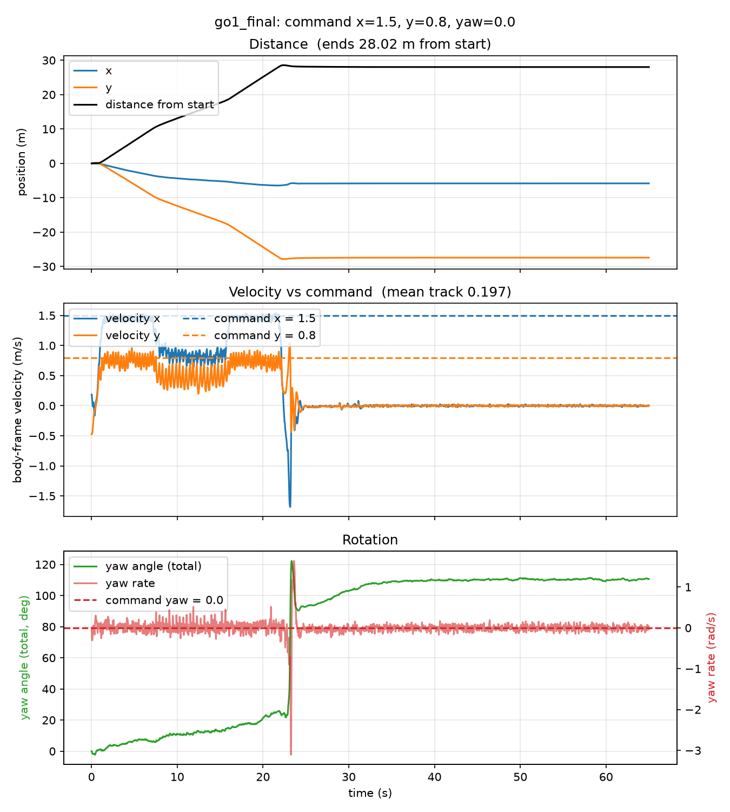
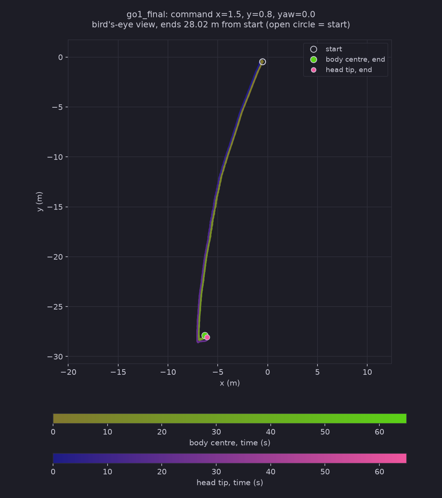

# Test Log 10.3 — Test 10.2 again with a policy trained on the ramp ground itself (local RTX 5060)

**Date:** 2026-11-08
**Result:** No visible gain. A policy trained for 122.88M steps on the ramp ground (`SlopeRingsGround_1`) crosses the 15° ramp in about 8.5 s (the flat-trained policy of Test 10.2: 9.1 s) and still fails at the 25° ramp: it climbs about 0.4 m up it, slides backwards and tumbles at 23.1 s (step 1156), 3.7 s earlier than the flat-trained policy did. It lies on its back for the remaining 42 s. One seed, one run.

**Purpose:** [Test 10.2](../Test10.2/Test10.2.md) used the Test 7 policy, trained on flat ground only, on the ramp ground at command 1.5 / 0.8 / 0. It crossed the 15° ramp and fell at the 25° ramp. Here the policy is **trained on the ramp ground** (the only change to the training is the ground) and then run with the same setup as Test 10.2, to see whether seeing slopes during training lets it get up the 25° ramp.

## Training

| Setting | Value |
|---|---|
| Ground | `Assets/Grounds/SlopeRingsGround_1.xml` (100 x 100 m, flat middle 20 x 20 m, 15° / 25° / 35° ring ramps with plateaus) |
| Task | Playground's `Go1` joystick environment loaded on that XML under the task name `rough_custom` (same as `rollout_terrain.py`), feet-only robot |
| Script | [Scripts/train_terrain.py](../../Scripts/train_terrain.py), run by [train_slanted.sh](./train_slanted.sh) in `~/go1_slanted` |
| PPO settings | those of `Go1JoystickRoughTerrain` (the same network as the flat task), stock domain randomization |
| `num_timesteps` / `num_evals` / `num_envs` / seed | 120,000,000 / 16 / 4096 / 0 (the Test 7 settings, so the two runs are comparable) |
| **Steps actually run** | **122,880,000** (15 epochs of 8,192,000) |
| Time | jit 1:03, training 24:44 |
| GPU memory | peak 4,574 MiB of 8,151 MiB (no out-of-memory, unlike Test 8) |
| Checks | the domain randomizer assumes the floor is geom 0, and it is (the script stops otherwise); a smoke run of 16.4M steps (5:06, 4,540 MiB) came first |
| Log, reward plot | [train.log](./train.log), [reward_plot.png](./reward_plot.png) (this run and Test 7 overlaid) |

Reward (evaluation episodes, on the ground each run was trained on):

| Steps | 24.6M | 49.2M | 65.5M | 73.7M | 98.3M | 122.9M |
|---|---|---|---|---|---|---|
| Test 7, flat | 19.28 | 19.19 | 22.41 | 24.41 | 26.70 | **26.94** |
| Test 10.3, ramp ground | 19.49 | 19.31 | 20.57 | 22.21 | 24.29 | **25.74** |

Same shape (a plateau near 19 to 20, then a climb), a little lower at the end. The two rewards are measured on different grounds, so I do not compare them as a score. Every training episode starts within 0.5 m of the centre (Playground's reset), so most of an episode is spent on the flat middle. I did not measure how often training reached the rings.

## Rollout (same as Test 10.2)

Command **1.5 / 0.8 / 0**, 65 s (3,250 steps), `SlopeRingsGround_1`, start in the middle, `PRNGKey(0)`, `Scripts/rollout_terrain.py` then `render_qpos.py` (`top`, `side`, `track`). Script: [run_test10_3.sh](./run_test10_3.sh). Files are in `slanted/`.

## Results

I checked the `track` video by frames (one every 2 s, and every 5th frame from 20.8 s to 23.9 s around the fall) and read the motion graph, the trail map and the rollout numbers. `top` and `side` were not watched.

| | Test 10.2 (flat-trained) | **Test 10.3 (ramp-trained)** |
|---|---|---|
| Fell (episode terminated) | yes, step 1340 (26.8 s) | **yes, step 1156 (23.1 s)** |
| Mean `track` over 65 s | 0.243 | **0.197** |
| Distance from start | 29.97 m | **28.02 m** |
| Reached the 15° ramp (d = 10 m) | 7.2 s | **7.2 s** |
| Crossed the 15° ramp (d = 18 m) | 16.3 s (9.1 s on the ramp) | **15.7 s (8.5 s on the ramp)** |
| Body speed on the flat (forward / sideways) | 1.49 / 0.75 m/s | **1.45 / 0.75 m/s** |
| Body speed on the 15° ramp | 0.85 / 0.54 m/s | **0.86 / 0.47 m/s** |
| Body speed on the plateau | 1.51 / 0.75 m/s | **1.46 / 0.74 m/s** |
| Reached the 25° ramp (d = 28 m) | 25.5 s | **22.0 s** |
| Highest body height | 2.52 m | **2.64 m** (plateau standing height is about 2.46 m) |
| Slowest forward speed | -0.18 m/s | **-1.68 m/s** (sliding backwards) |
| Upright at the end | -0.995 | **-0.983** |

- **0 to 22 s:** it behaves like the flat-trained policy. Full command on the flat, about 0.86 / 0.47 m/s while crossing the 15° ramp (7.2 to 15.7 s), full command again on the plateau.
- **22.0 to 23.1 s, the 25° ramp:** it reaches d = 28 m at 22.0 s and walks onto the ramp. Body height rises to 2.64 m, about 0.2 m above the plateau, which is about 0.4 m of ramp. At about 23.1 s the forward speed swings to -1.68 m/s (it slides back), the yaw rate peaks at about -3 rad/s, and it tumbles. In the track video it rears up nose first and flips over backwards. The flat-trained policy stalled at the foot and tumbled sideways.
- **From 24 s to 65 s:** nothing moves. It lies on its back (upright -0.983) at (-6.3, -27.9), body height 1.89 m, which is below the plateau surface (about 2.14 m) as in the earlier runs (feet-only collision, my reading, not tested). The track video again only shows legs and the trunk against the edge of the terrain.
- **Heading:** the yaw drifts to about +25° over the first 22 s (the flat-trained policy drifted to +85° over 25 s), so the path is a nearly straight line. The yaw then jumps at the tumble (+110° at the end).

## Takeaways

1. **Training on the ramp ground, as it is, did not get the policy up the 25° ramp.** The 15° ramp was already easy at this command for the flat-trained policy (Test 10.2), and the ramp-trained one does the same (8.5 s against 9.1 s, same speeds within about 0.1 m/s). The one thing I hoped to change, the 25° ramp, still ends in a fall.
2. **The 3.7 s earlier fall and 2 m shorter distance are not a clear difference.** One seed each, one start, and the path and heading differ (the flat-trained one had a path that curved by 85°). I would not call the new policy worse on this evidence.
3. **The fall looks different** (backward slide and flip after climbing about 0.4 m, instead of a stall and a sideways tumble), but both happen within about 1.3 s of reaching the 25° ramp.
4. **My guess for why it did not help, not tested:** training episodes start on the flat middle and last 20 s, so the 25° ring (28 m from the centre) may almost never be reached. A ground with random start points, or a curriculum, would put the 25° ramp in front of the robot more often. The first thing to measure is how far training episodes get, using the trained policy and random commands.

## Caveats

- One training run (seed 0), one policy, one rollout, one command. In the flat runs of Test 9 the switch to walking landed anywhere from about 49M to after 68.8M steps depending on the seed, so a single run is weak evidence in either direction.
- Training ran with the stock domain randomization and the Test 7 step count and evaluations. I did not tune anything for slopes.
- The training reward is not comparable to Test 7's, because it is measured on a different ground.
- The track video was checked by frames, not frame by frame, and `top` and `side` were not watched.
- Contact points in the videos are recomputed on the CPU, so they can differ slightly from the GPU simulation.
- `train_terrain.py`, `train_slanted.sh` and `run_test10_3.sh` were written by Claude from my request (to go in Declaration.md).
