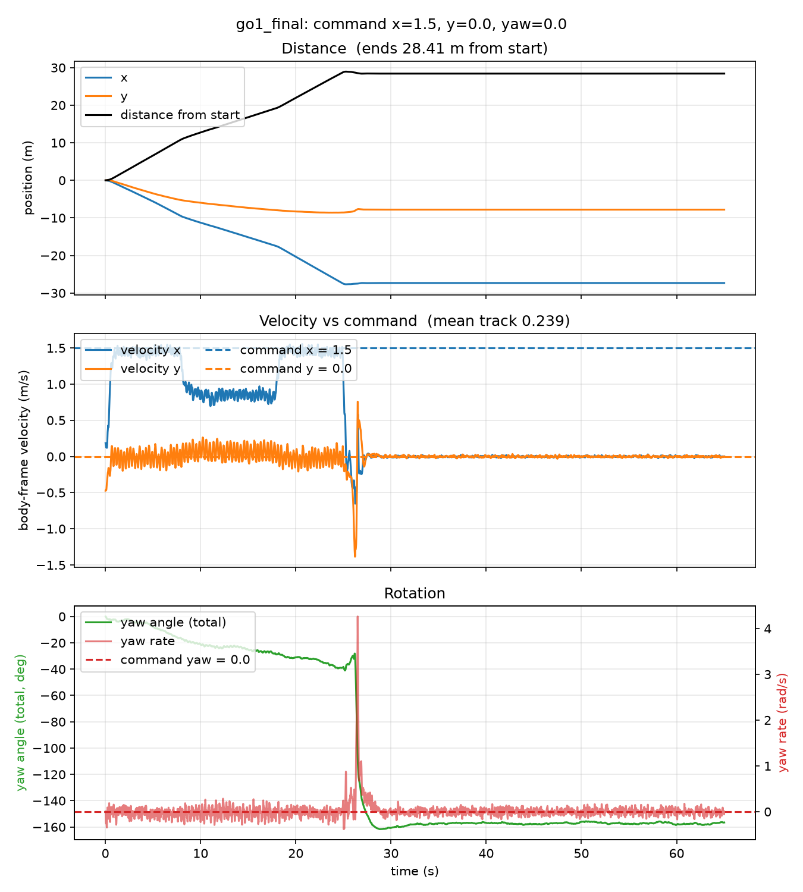
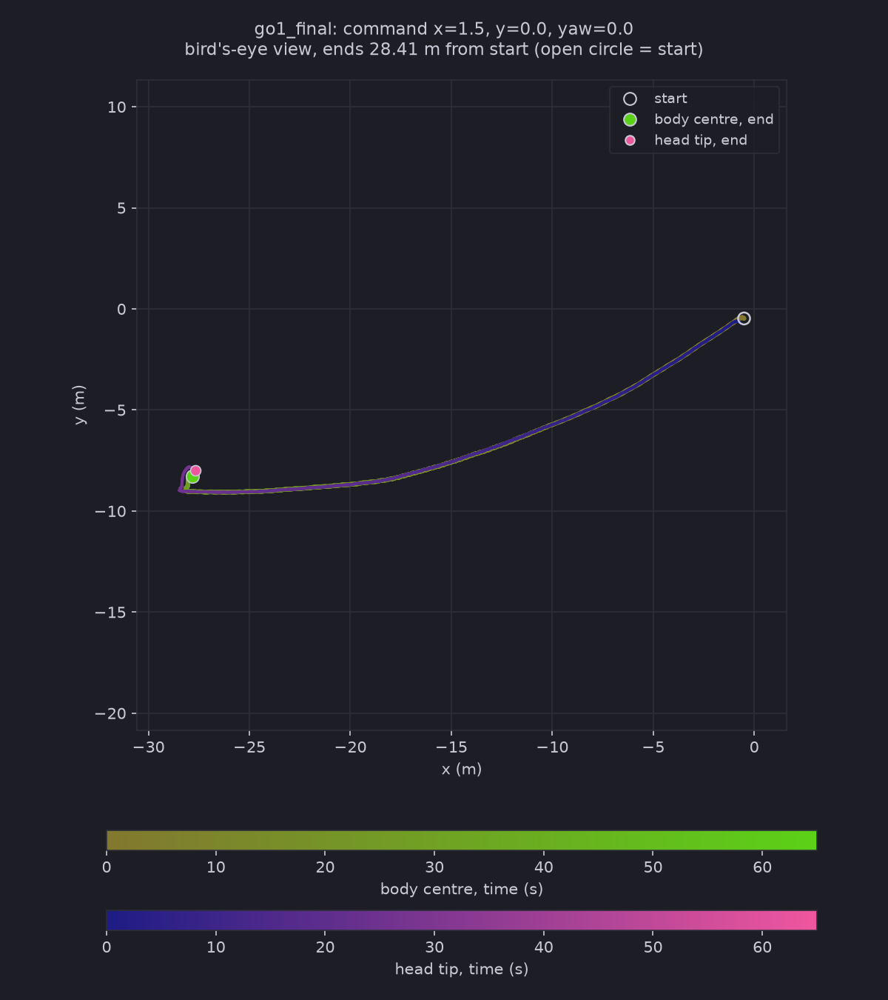
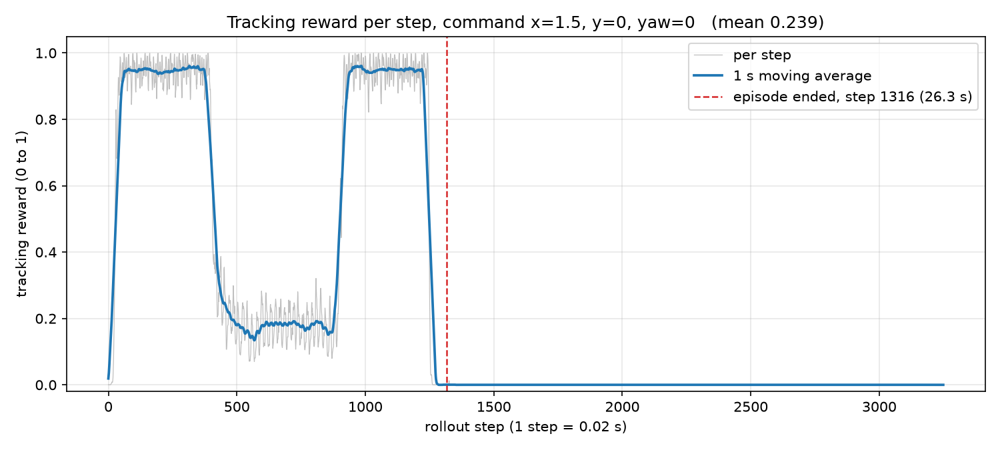
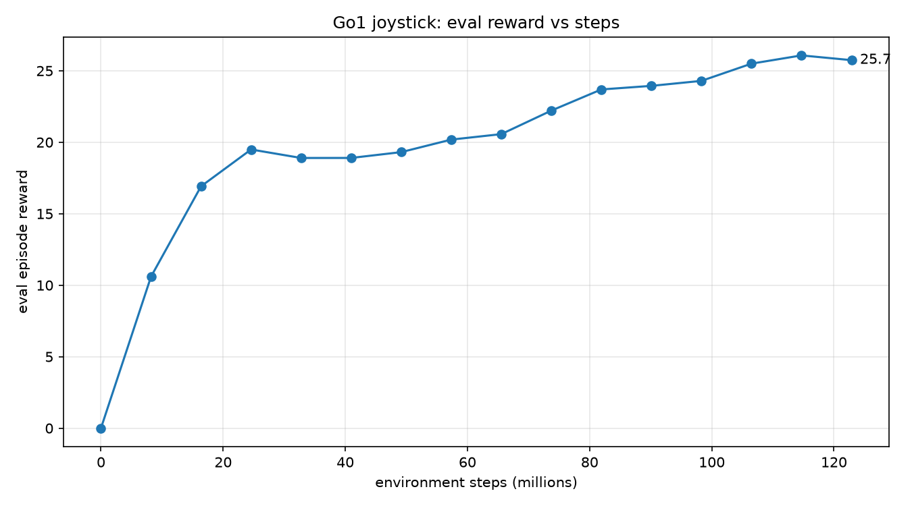

# Test Log 10.4 — Test 10.3's ramp-trained policy with the sideways command removed (1.5 / 0 / 0)

**Date:** 2026-11-08
**Result:** Same outcome as with the sideways command. The ramp-trained policy walks the flat middle at 1.44 m/s, crosses the 15° ramp in 10.0 s at 0.86 m/s forward, crosses the plateau at full speed, and stalls at the foot of the 25° ramp (25.0 s). It crouches, topples at about 26.3 s (episode terminated at step 1316) and lies on its back for the remaining 38 s. One run.

**Purpose:** [Test 10.3](../Test10.3/Test10.3.md) (command 1.5 / 0.8 / 0) failed at the 25° ramp. Is the sideways part of the command what makes the 25° ramp fail? Run the same policy (`~/go1_slanted/go1_final`, trained on the ramp ground), same ground, start, length and cameras, with y = 0: command **1.5 / 0 / 0**.

## Conditions (same as Test 10.3 except the command)

| Setting | Value |
|---|---|
| Policy | Test 10.3's, `~/go1_slanted/go1_final` (122,880,000 steps, trained on `SlopeRingsGround_1`) |
| Robot | `go1_mjx_feetonly.xml` (only the feet collide with the ground), no hat |
| Ground | `SlopeRingsGround_1` (flat to d = 10 m, 15° ramp to 18 m, plateau to 28 m, 25° ramp to 35 m, and so on) |
| Command (x / y / yaw) | **1.5 / 0 / 0**, held for the whole run (Test 10.3: 1.5 / 0.8 / 0) |
| Length, start | 65 s = 3,250 steps, middle of the terrain, `PRNGKey(0)` |
| Rollout, videos | `Scripts/rollout_terrain.py`, then `Scripts/render_qpos.py` (`top`, `side`, `track`) |
| Run script | [run_test10_4.sh](./run_test10_4.sh), progress in `~/test10_4_progress.txt` |

Files are in `slanted/`: the motion data (`.npz`), `motion_*.png`, `trail_*.png`, `rollout_out.txt` and the three videos.

## Results

I checked the `track` video by frames (one every 2 s, and every 5th frame from 23.6 s to 26.7 s around the fall) and read the motion graph, the trail map and the rollout numbers. `top` and `side` were not watched. Distance `d` is the ring distance max(|x|, |y|).

| | Test 10.2 (flat-trained, 1.5 / 0.8) | Test 10.3 (ramp-trained, 1.5 / 0.8) | **Test 10.4 (ramp-trained, 1.5 / 0)** |
|---|---|---|---|
| Fell (episode terminated) | step 1340 (26.8 s) | step 1156 (23.1 s) | **step 1316 (26.3 s)** |
| Mean `track` over 65 s | 0.243 | 0.197 | **0.239** |
| Distance from start | 29.97 m | 28.02 m | **28.41 m** |
| Reached the 15° ramp (d = 10 m) | 7.2 s | 7.2 s | **7.9 s** |
| Time on the 15° ramp (d 10 to 18 m) | 9.1 s | 8.5 s | **10.0 s** |
| Forward speed on the flat / 15° ramp / plateau | 1.49 / 0.85 / 1.51 | 1.45 / 0.86 / 1.46 | **1.44 / 0.86 / 1.44 m/s** |
| Sideways speed on the flat / 15° ramp | 0.75 / 0.54 | 0.75 / 0.47 | **-0.01 / 0.06 m/s** |
| Reached the 25° ramp (d = 28 m) | 25.5 s | 22.0 s | **25.0 s** |
| Highest body height | 2.52 m | 2.64 m | **2.53 m** (standing on the plateau is about 2.46 m) |
| Slowest forward speed | -0.18 m/s | -1.68 m/s | **-0.65 m/s** |

- **0 to 7.9 s, flat middle:** it follows the command, 1.44 m/s forward and about 0 sideways. Heading drifts to about -25° over the first 18 s, so the path is a gentle curve, not a straight line.
- **7.9 to 18.0 s, the 15° ramp:** forward speed drops to 0.86 m/s and stays there with no stops. The ring distance takes 10.0 s against 8.5 s in Test 10.3, because there the 0.47 m/s of sideways speed added to the speed along the ring normal. The forward speed on the ramp is the same.
- **18.0 to 25.0 s, the plateau:** back to 1.44 m/s.
- **25.0 to 26.3 s, the foot of the 25° ramp:** forward speed falls from 1.43 (24 s) to 0.95 (25 s) and below zero (-0.35 at 26 s). It only gets about 0.07 m up the ramp (highest body height 2.53 m). In the track video it crouches low with the front legs bent, then topples at about 26.3 s (yaw rate peak about 4.3 rad/s, sideways speed spike about -1.4 m/s). The total heading ends at -157°.
- **From 27 s to 65 s:** nothing moves. It lies on its back (upright -0.987) at (-27.8, -8.3), body height 1.88 m, below the plateau surface (about 2.14 m), as in the earlier runs (feet-only collision, my reading, not tested). The track video again only shows the feet.

## Reward

A rollout has no training reward of its own, so these are the two reward views that fit Test 10.4.

**Reward per step during the rollout** ([track_steps.png](./track_steps.png), made by [Scripts/plot_track_steps.py](../../Scripts/plot_track_steps.py)). `track` is the velocity-tracking term of the reward for each 0.02 s step, from 0 (far from the command) to 1 (exactly the command). It is one term of the training reward, not the whole reward: the energy and falling terms are not saved in the rollout.

| Phase | Steps | Mean `track` |
|---|---|---|
| Flat middle (step 100 to the ring at 397) | 297 steps | **0.948** |
| 15° ramp (steps 397 to 898) | 501 steps | **0.199** |
| Plateau (steps 948 to 1249) | 301 steps | **0.948** |
| Whole walk until the fall (steps 0 to 1316) | 1316 steps | 0.591 |
| Whole 65 s run (the 1934 steps lying on its back score 0) | 3250 steps | 0.239 |

On the 15° ramp the policy gets only about a fifth of the tracking reward (0.199 against 0.948), because it moves at 0.86 m/s against a command of 1.5. It never stops there, so the cost is slow progress, not a fall. After the fall the reward is 0 for the remaining 1934 steps.

**Training reward of this policy against steps** ([reward_plot.png](./reward_plot.png), from [Test10.3's train.log](../Test10.3/train.log)). The policy is Test 10.3's, so this is the same training curve: 0 at the start, a plateau near 19 from about 25M to 50M steps, then a climb to 25.74 at 122.88M. The evaluation episodes are on the ramp ground.

## Takeaways

1. **The sideways command is not what stops the 25° ramp.** With y = 0 the policy still stalls at the foot at 25.0 s and falls at 26.3 s. That is the same place and almost the same time as the flat-trained policy in Test 10.2 (26.8 s). Test 10.3 (23.1 s, slid backwards after about 0.4 m of ramp) was the outlier.
2. **Forward speed on the 15° ramp is about 0.85 m/s in all three runs (0.85, 0.86, 0.86), flat-trained or ramp-trained, with or without the sideways command,** at a forward command of 1.5. In Test 10 the flat-trained policy at a forward command of 0.85 managed about 0.4 m/s moving on the same ramp. So the ramp seems to take roughly half the forward command off the walking speed. That is four runs, and I did not test it with other commands.
3. **The 25° ramp has now beaten the policy in every run** (flat-trained at 0.3 to 1.5 m/s forward in Test 10's search, flat-trained at 1.5 / 0.8 in 10.2, ramp-trained at 1.5 / 0.8 in 10.3 and at 1.5 / 0 in 10.4).
4. **The fall is the same each time:** a tumble and no way to get up (it lies on its back until 65 s).

## Caveats

- One policy, one seed, one start, one run. The difference between 26.3 s (this run) and 23.1 s (Test 10.3) is one run each, so I would not read it as a sideways-command effect.
- The "about half the forward command" idea comes from four runs at two commands and is a pattern, not a measurement.
- The track video was checked by frames, not frame by frame, and `top` and `side` were not watched.
- Contact points in the videos are recomputed on the CPU, so they can differ slightly from the GPU simulation.
- The run script was written by Claude from my request (to go in Declaration.md).
