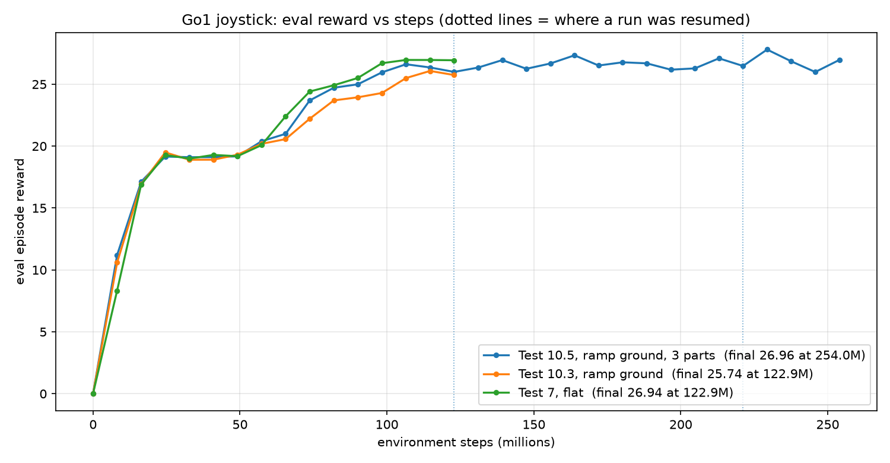
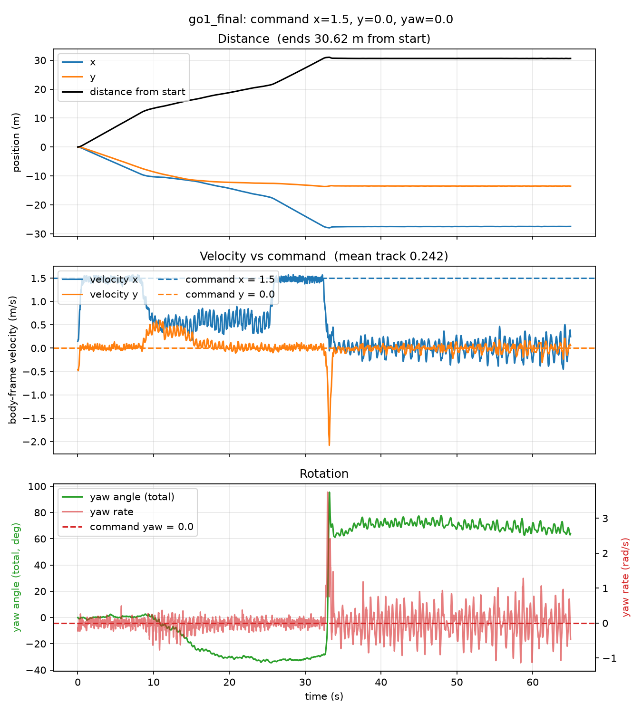
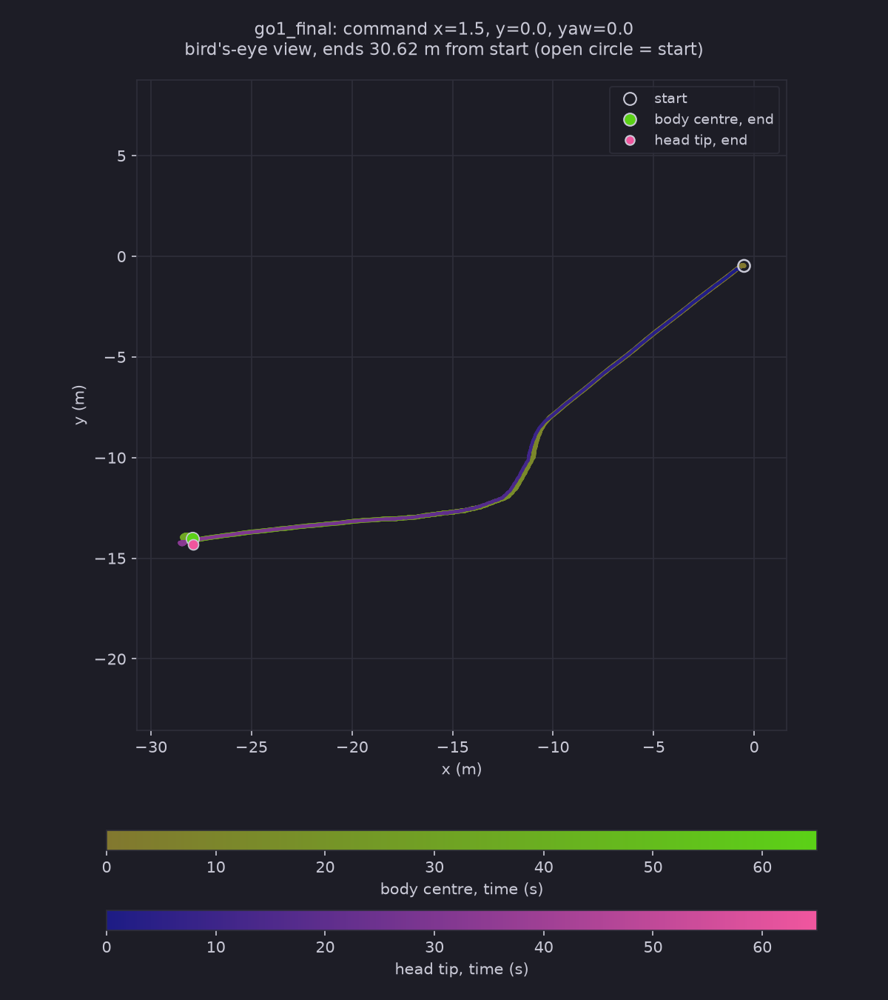

# Test Log 10.5 — Test 10.4 again with a policy trained for 253,952,000 steps (about twice as long) on the ramp ground

**Date:** 2026-11-08
**Result:** No gain. Doubling the training steps did not change the training reward (it stays near 26.5 to 27 after about 110M steps) and did not get the policy up the 25° ramp: it stalls at the foot at 32.4 s, topples at 33.1 s (episode terminated at step 1655) and lies on its back for the rest of the run. On the 15° ramp it was slower than the 123M policy (0.59 m/s forward against 0.86, 17.1 s against 10.0 s). One run, one policy, and the training was done in three resumed parts after two out-of-memory crashes, so it is not one unbroken run.

**Purpose:** [Test 10.3](../Test10.3/Test10.3.md) and [10.4](../Test10.4/Test10.4.md) used a policy trained for 122.88M steps on the ramp ground and fell at the 25° ramp. Does training for about twice as long (250M steps requested) change that? Same ground, same settings except the length, same rollout as Test 10.4 (command 1.5 / 0 / 0).

## Training (in three parts)

The first plan was one run of 250M steps with 32 evaluations ([train_250M.sh](./train_250M.sh)), which keeps the reset interval at 200 steps, the same as Test 7 and Test 10.3 (8,192,000 steps per evaluation period / 4096 envs / 10 resets). It crashed twice with a Warp CUDA out-of-memory error, so it was finished in two more parts. Each part restores only the weights of the last checkpoint of the part before (`--resume` in [Scripts/train_terrain.py](../../Scripts/train_terrain.py)); the optimizer state and the step counter start again.

| Part | Script | Settings | Seed | Steps run | How it ended | Log |
|---|---|---|---|---|---|---|
| 1 | [train_250M.sh](./train_250M.sh) | 250M requested, 32 evaluations, 4096 envs | 0 | 122,880,000 (15 epochs) | crashed in epoch 16 (Warp CUDA out of memory), about 27 min in | [train_part1_crashed.log](./train_part1_crashed.log) |
| 2 | [train_250M_part2.sh](./train_250M_part2.sh) | resume from part 1's `ckpt_122880000`, 122.88M requested, 16 evaluations | 1 | 98,304,000 (12 epochs) | crashed in epoch 13 (the same error), about 23 min in | [train_part2_crashed.log](./train_part2_crashed.log) |
| 3 | [train_250M_part3.sh](./train_250M_part3.sh) | resume from part 2's `ckpt_98304000`, 32.77M requested, 5 evaluations | 2 | 32,768,000 (4 epochs) | finished (jit 0:58, training 7:54), `go1_final` saved | [train_part3.log](./train_part3.log) |
| **Total** | | | | **253,952,000** | | |

- **Check that the restore worked:** the first evaluation of each resumed part is taken before any training. Part 2 started at 26.43 (part 1 ended at 25.99) and part 3 at 26.93 (part 2 ended at 26.47), so the weights came back and the reward did not restart from 0.
- **The crashes:** both were `Warp CUDA error 2: out of memory (in function wp_alloc_device_async)` during an epoch, while the GPU log showed a flat 4,578 MiB of 8,151 MiB. Test 8 died the same way after 14 epochs, and Test 10.3 finished its 15. The crash does not come at a fixed epoch (15, 12, 14) but after roughly 21 to 28 minutes of a process. I do not know the cause. Keeping each process under about 20 minutes (10 to 12 epochs) is a workaround, not a fix.
- **Reward plot:** [reward_plot.png](./reward_plot.png), made by [Scripts/plot_reward_parts.py](../../Scripts/plot_reward_parts.py), joins the three parts into one line (the dotted lines mark the joins) next to Test 10.3 and Test 7.

| Steps | Eval reward, mean (min to max) |
|---|---|
| 106M to 123M | 26.3 (26.0 to 26.6) |
| 123M to 180M | 26.7 (26.3 to 27.3) |
| 180M to 254M | 26.7 (26.0 to 27.8), last 26.96 |

The training reward is flat after about 110M steps. It is within noise of Test 7's 26.9 at 123M, and the same picture as the flat run (26.7 at 98M, 26.9 at 123M). The evaluation episodes are on the ground the policy was trained on.

## Rollout (same as Test 10.4)

Command **1.5 / 0 / 0**, 65 s (3,250 steps), `SlopeRingsGround_1`, start in the middle, `PRNGKey(0)`, policy `~/go1_slanted_250m_part3/go1_final`. Script [run_test10_5.sh](./run_test10_5.sh), files in `slanted/`.

I checked the `track` video by frames (one every 2 s for the first 36 s, and every 5th frame from 31.4 s to 34.4 s around the fall) and read the motion graph, the trail map and the rollout numbers. `top` and `side` were not watched.

| | Test 10.4 (122.88M steps) | **Test 10.5 (253.95M steps)** |
|---|---|---|
| Fell (episode terminated) | step 1316 (26.3 s) | **step 1655 (33.1 s)** |
| Mean `track` over 65 s (until the fall) | 0.239 (0.591) | **0.242 (0.475)** |
| Distance from start | 28.41 m | **30.62 m** |
| Reached the 15° ramp (d = 10 m) | 7.9 s | **8.4 s** |
| Crossed the 15° ramp (d = 18 m); time on it | 18.0 s; 10.0 s | **25.5 s; 17.1 s** |
| Forward speed on the flat / 15° ramp / plateau | 1.44 / 0.86 / 1.44 m/s | **1.47 / 0.59 / 1.47 m/s** |
| Reached the 25° ramp (d = 28 m) | 25.0 s | **32.4 s** |
| Highest body height | 2.53 m | **2.52 m** (standing on the plateau is about 2.46 m) |
| Slowest forward speed | -0.65 m/s | **-0.45 m/s** |
| Upright at the end | -0.987 | **-0.997** |

- **Flat middle (to 8.4 s):** full command, 1.47 m/s forward.
- **15° ramp (8.4 to 25.5 s):** forward speed 0.59 m/s on average (0.35 to 0.78 m/s, with a clear oscillation), against 0.86 m/s for the 123M policy. It does not stop for more than 1 s, but it also drifts sideways at about 0.3 to 0.5 m/s between 9 and 14 s and turns about -30° (the path in the trail map bends). It takes 17.1 s to cross, against 10.0 s.
- **Plateau (25.5 to 32.4 s):** back to 1.47 m/s.
- **25° ramp (32.4 to 33.1 s):** the same as Test 10.4. Forward speed falls from 1.43 m/s (32 s) to 0.22 m/s (33 s), it reaches the foot (d = 28.4 m) and topples 0.7 s later without climbing (highest body height 2.52 m, no higher than the plateau). In the track video it crouches at the foot and flips over (yaw rate peak about 3.8 rad/s, sideways speed about -2.1 m/s).
- **After the fall (35 s to 65 s):** it lies on its back (upright -0.94 to -1.0) at (-28.0, -14.0), within 0.13 m of where it fell. **Unlike Tests 10.3 and 10.4, it keeps moving its legs:** the spread of the 12 joint angles is 0.086 rad (0.012 and 0.009 in 10.3 and 10.4) and the mean body rotation rate is 0.38 rad/s (0.04 and 0.05). The track video shows the legs waving, as if it were still trying to walk (see takeaway 4). It does not get up.

## Takeaways

1. **More steps did not get the policy up the 25° ramp.** The fall is the same as in Test 10.4: it stalls at the foot and topples within a second of reaching it. The later fall time (33.1 s against 26.3 s) is only because the 15° ramp took longer, 7.4 s more.
2. **The training reward stopped improving after about 110M steps** (26.3, 26.7, 26.7 in three windows), so doubling the steps on this ground bought nothing in the reward either. This agrees with the flat-ground result of Test 7.
3. **The 254M policy is slower on the 15° ramp** (0.59 against 0.86 m/s forward). I cannot say whether that is an effect of the extra steps, of the restarts (the optimizer state was reset twice, the seeds changed), or just the spread between runs. It needs repeats to tell.
4. **After falling it struggles to walk, but does not get up.** On its back the policy still gets the command 1.5 / 0 / 0 and keeps trying to move its legs. I checked the joint angles in `slanted/*.npz`: while walking (10 to 32 s) the 12 joints have a clear 2.0 Hz gait and a spread of 0.05 to 0.24 rad per joint; on its back (36 to 65 s) there is no clean gait (the spectrum is flat, the highest peak at 1.1 Hz is only 3% of the total), the spread is mostly in one hip joint (0.22 rad) and the others are 0.01 to 0.14 rad, and the mean spread grows from 0.05 rad at 34 s to about 0.09 to 0.11 rad later. So it is irregular flailing in the way of a walk that it cannot carry out, not a new gait, and it never turns the body back over. The two earlier policies lay still. Why this one moves and they did not, I do not know (one run, three resumed parts).
5. **Practical:** training on this ground crashes with a CUDA out-of-memory error after about 21 to 28 minutes of a process. For long runs, restart in parts of 10 to 12 epochs.

## Caveats

- One policy, one rollout, one command, one start. The training was in three resumed parts with different seeds, with the optimizer state reset at each join, so it is not the same as one unbroken 250M run.
- The crash cause is unknown. The peak GPU memory in the log never went above 4,578 MiB.
- The reward is an evaluation on the training ground, so it says little about the 25° ramp, which training rarely reaches (my untested guess from Test 10.3: every episode starts in the flat middle).
- The track video was checked by frames, not frame by frame, and `top` and `side` were not watched.
- Contact points in the videos are recomputed on the CPU, so they can differ slightly from the GPU simulation.
- The scripts (`train_250M*.sh`, `run_test10_5.sh`, `Scripts/plot_reward_parts.py`, the `--resume` option in `train_terrain.py`) were written by Claude from my request (to go in Declaration.md).
