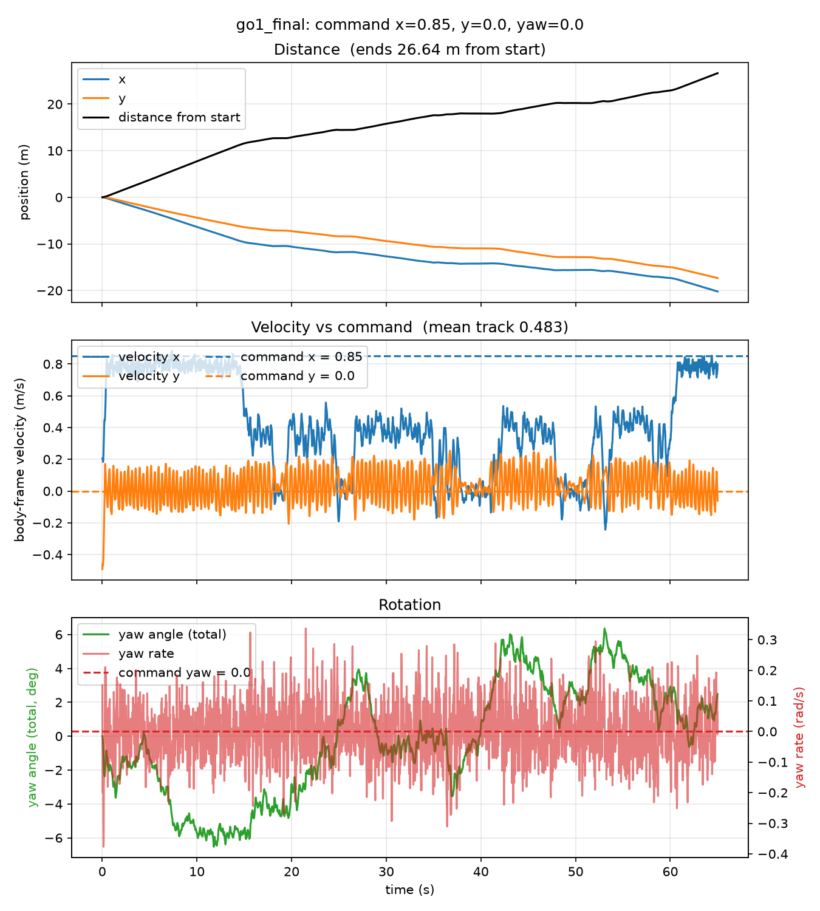
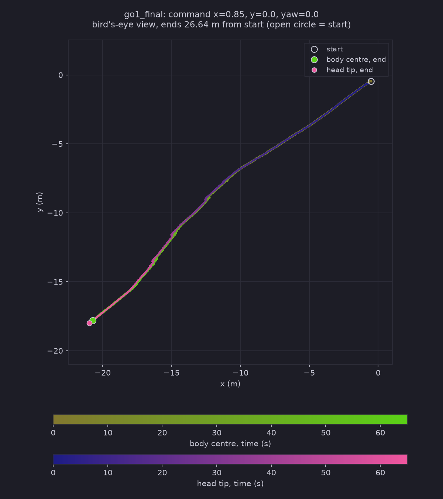
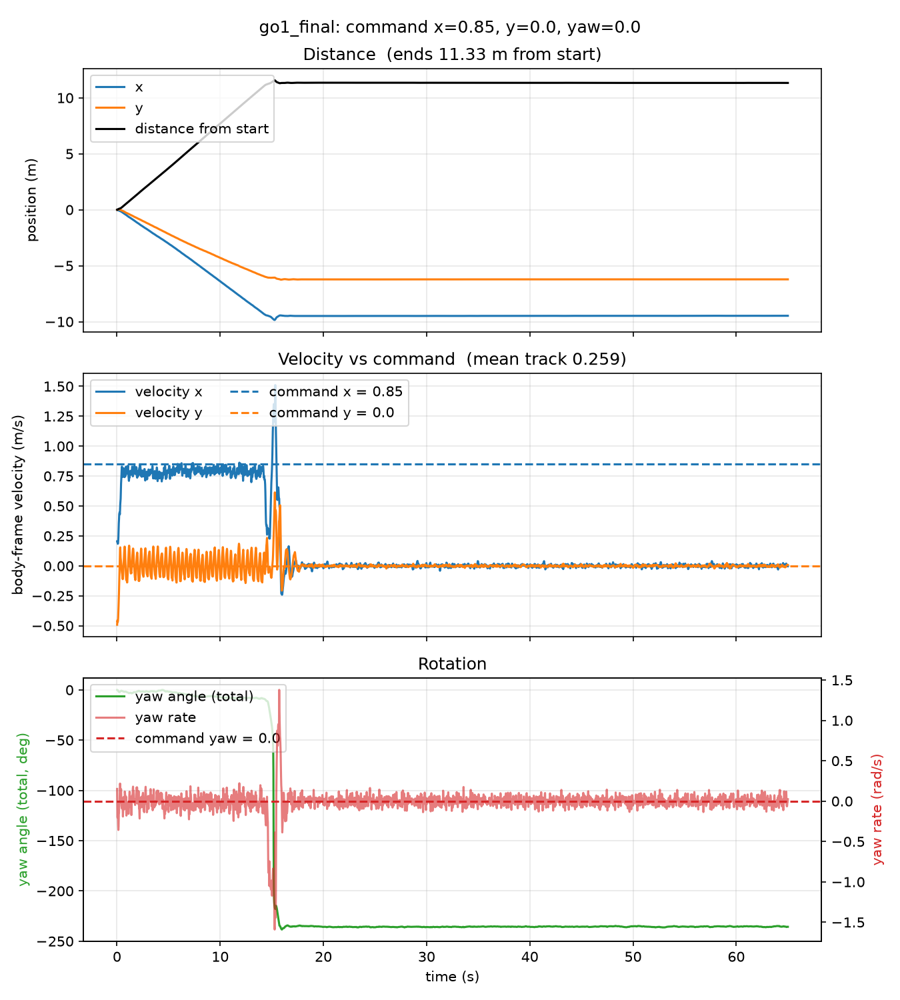
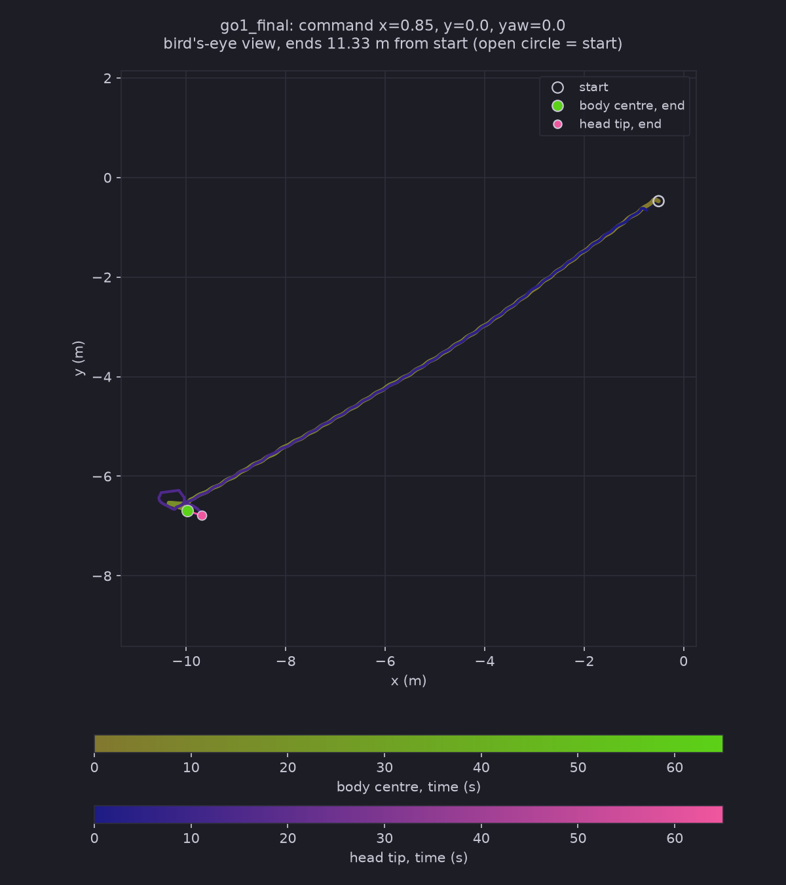

# Test Log 10 — Slowest walk up the ramps, and the stairs (Test 7 policy, no new training)

**Date:** 2026-11-04
**Result:** The Test 7 policy climbs the 15° ramp at 0.85 m/s but slowly and in stop-and-go (about 0.4 m/s while moving, stalled for 1 to 3 s several times), reaching the plateau at 60.5 s of 65 s without a fall. On the 15° stairs it fell at the first step (15.2 s) and lay upside down for the remaining 50 s (`track` 0.259 over 65 s). One policy, one run each; the 25° and 35° rings were not reached.

**Purpose:** Find the slowest forward command that still gets the Test 7 policy up the first 15° ramp, then run that same command, from the same start, on a ramp terrain (`slanted`) and a stair terrain (`staired`) and record 3 camera views of each for about 60 s.

Nothing is trained in this test. The policy was only ever trained on flat ground (see [Test 7](../Test7/Test7.md)), so every slope and step here is new to it.

## Conditions (identical on both terrains)

| Setting | Value |
|---|---|
| Policy | Test 7, checkpoint `go1_final` (122,880,000 steps, flat ground), folder `~/go1_test8/go1_final` |
| Task / robot | `Go1JoystickFlatTerrain` config, `go1_mjx_feetonly.xml` (only the feet collide with the ground), no hat |
| Command (x / y / yaw) | **0.85 / 0 / 0**, held for the whole run |
| Why 0.85 | Slowest forward speed that reached the first plateau in the climb search below (0.80 did not in 80 s) |
| Length | 65 s = 3,250 steps (1 step = 0.02 s) |
| Start | Middle of the terrain, flat, z = 0, same reset for both (`PRNGKey(0)`) |
| Rollout | `Scripts/rollout_terrain.py <ground.xml> 0.85 0 0 go1_final --seconds 65` (GPU, no video) |
| Videos | `Scripts/render_qpos.py`, saved joint angles replayed on the CPU, 640 x 480, 25 fps (every second step), contact points shown |
| Cameras | `top` (looking down), `side` (fixed side view), `track` (follows the robot) |
| Run script | [run_test10.sh](./run_test10.sh), progress in `~/test10_progress.txt` |
| Hardware | NVIDIA GeForce RTX 5060 Laptop (8 GB), WSL2 Ubuntu 24.04, plugged in |

If the robot falls, the rollout stops counting it as walking (the run is marked "fell at step N") but the video still covers the full 65 s of saved states.

## The two terrains

Made by [Scripts/make_terrain.py](../../Scripts/make_terrain.py) from the layout I described, as square rings around the middle. Distance `d = max(|x|, |y|)` from the centre, in metres. The files are in `Assets/Grounds/`.

| Ring (d) | Slanted ground (`SlopeRingsGround_1`) | Staired ground (`StairRingsGround_1`) |
|---|---|---|
| 0 to 10 | flat at 0 | flat at 0 |
| 10 to 18 | ramp, 15° | stairs, 15° average (0.40 m tread, 0.107 m rise) |
| 18 to 28 | flat plateau | flat plateau |
| 28 to 35 | ramp, 25° | stairs, 25° average (0.20 m tread, 0.093 m rise) |
| 35 to 45 | flat plateau | flat plateau |
| 45 to 50 | ramp, 35° (the terrain ends at 50) | stairs, 35° average (0.15 m tread, 0.105 m rise) |

| | Slanted | Staired |
|---|---|---|
| Size | 100 x 100 m (50 m from the centre to each edge) | same |
| Grid | 0.10 m cells (1001 x 1001) | 0.05 m cells (2001 x 2001) |
| Highest point | at the edge | at the edge |

- The middle flat square is 20 x 20 m (10 m from the centre each way), which is how I read "middle 10x10 square" as a distance from the centre. Say so if you meant 10 x 10 m in total.
- A stair riser cannot be vertical on this kind of ground (a heightfield), so each riser is a steep ramp one cell (5 cm) wide.
- The stair treads are shallow so the average angle matches the ramps. They are not real building stairs.

## Step 1: finding the slowest speed that climbs

`Tests/Test10/climb_sweep.py` rolls out the same policy on the ramp terrain with command `v / 0 / 0` for 80 s, once per speed, and counts it as **arrived** when the body gets to `d >= 18.5 m` and is at least 2.0 m above the start, upright, without having fallen.

Speeds tried: 0.30, 0.50, 0.70, 0.90, 1.10, 1.30, 1.50, then 0.75, 0.80, 0.85 to narrow it down. Files: `climb_sweep_slanted.csv/.txt` and `climb_sweep_slanted_fine.csv/.txt`.

| Speed (m/s) | On first plateau | Arrived at | Farthest d (m) | Highest z (m) | Ended |
|---|---|---|---|---|---|
| 0.30 | no | - | 10.16 | 0.38 | standing / stuck at the foot of the ramp |
| 0.50 | no | - | 10.24 | 0.39 | standing / stuck |
| 0.70 | no | - | 11.12 | 0.62 | standing / stuck |
| 0.75 | no | - | 11.56 | 0.74 | standing / stuck |
| 0.80 | no | - | 16.77 | 2.13 | still climbing at 80 s, not on the plateau |
| **0.85** | **yes** | **61.3 s** | 28.13 | 2.53 | still going |
| 0.90 | yes | 44.9 s | 28.15 | 2.56 | still going |
| 1.10 | yes | 27.6 s | 28.16 | 2.56 | still going |
| 1.30 | yes | 23.3 s | 28.49 | 2.56 | fell at 78 s |
| 1.50 | yes | 21.4 s | 28.21 | 2.56 | fell at 31 s |

- No speed got past the 25° ramp (every run stopped at d of about 28 or fell), so Test 10 only compares the 15° ring and the plateau after it.
- 0.85 m/s only just makes it: it reaches the plateau at 61 s of a 65 s run, which is why the videos are 65 s and not 60 s.
- The search was done on the ramp terrain only. The stairs use the same speed, not their own minimum.

## Results

I checked the two `track` videos by frames, one every 4 s (16 frames each), together with the motion graphs, the trail maps and the rollout numbers. The `top` and `side` videos were not watched. The numbers are from the saved rollout (`rollout_out.txt`, the `.npz` files).

| | Slanted (ramp) | Staired (stairs) |
|---|---|---|
| Fell (episode terminated) | no | **yes, at step 758 (15.2 s)** |
| Mean `track` over 65 s | 0.483 | 0.259 |
| Distance from start | 26.64 m | 11.33 m |
| Reached the first ring (d = 10 m) at | 14.7 s | 14.7 s (same flat start, so the two runs are the same until here) |
| Reached the first plateau (d = 18 m) at | 60.5 s | never |
| Body height, highest | 2.47 m (plateau) | 0.36 m |
| Upright (1 = level) | min 0.970, 1.000 at the end | min -0.980, -0.963 at the end |
| Heading change | within about 6° the whole time | one flip of about -235° at 15 s, then still |

### Slanted: it gets up, slowly

- **0 to 14.7 s, flat middle:** body speed about 0.8 m/s against the command 0.85 (5-second means 0.75, 0.80, 0.77), the same as flat ground in Test 7.
- **14.7 s onwards, the 15° ramp:** body speed drops to about 0.4 m/s while it is moving (5-second means 0.07 to 0.37). It stalls (speed under 0.1 m/s for more than 1 s) at 25.1 to 26.3 s (d 12.3 m), 38.0 to 41.4 s (d 14.8 m) and 48.2 to 51.4 s (d 16.2 m), and it dips in between as well. It climbs the 2.1 m rise in about 46 s, so the 8 m of ramp is covered at about 0.17 m/s of distance from the centre, a fifth of the command.
- **After 60.5 s, on the plateau:** speed jumps straight back to about 0.8 m/s. The reason for the slow climb is the slope, not the policy or the command.
- **Heading:** the yaw stays between -6° and +6°, so it climbed in a straight line. The trail map is one nearly straight line from (-0.5, -0.5) to (-20.7, -17.8).
- **Track video (frames every 4 s):** the same trot as on flat ground, upright all the way, no stumbling. The ramp edge shows as a diagonal line at about 12 s. At 60 s the camera shows the flat plateau.

### Staired: it falls at the first step and stays down

- **0 to 14.7 s:** identical to the ramp run, about 0.8 m/s on the flat middle.
- **At 14.7 s it reaches the first riser at full speed.** Speed drops to about 0.25 m/s, then spikes to 1.5 m/s while the yaw swings through about -235° in about 1 s (yaw rate peak about 1.4 rad/s): it tumbles over. The episode is terminated at 15.2 s.
- **From 16 s to 65 s nothing moves:** speed 0.00 m/s, yaw constant, distance stuck at 11.33 m. Upright is -0.96 to -0.98, so it is on its back. Body height is -0.23 m, below the flat start level of 0.
- **Track video:** normal trot until about 12 s, with the stair edges visible ahead. From 16 s to the end the frame never changes (it shows only the four foot spheres against the step surface; there is no trunk in view). Both are consistent with the data above. My reading, not tested: this robot file collides only with its feet, so once it is on its back the trunk has nothing to rest on and sinks under the terrain surface, which would also explain the negative height.
- **Trail map:** a straight line to x = -10.4, then a small loop where it flipped. The last 50 s add nothing.

### Takeaways

1. **A policy that never saw a slope can still climb a 15° ramp,** but only at 0.85 m/s or more, and then slowly and in stop-and-go (Step 1: 0.80 m/s fails in 80 s, 0.85 reaches the plateau at 61 s). Nothing got past the 25° ring.
2. **The same policy and speed fail on 15° stairs at the first step** (flip at 15.2 s, no recovery). The stairs have the same average angle as the ramp, so the angle is not the reason. The steps are, and the policy cannot see them (it has no height input and was trained on flat ground only). Which part of the step trips it (the 5 cm steep riser, the 0.107 m rise, or the speed) is not tested.
3. **The speed that is the minimum for the ramp was not chosen for the stairs.** 0.85 m/s may be the wrong speed for stairs. A slower or faster command could behave differently, and I did not try one.
4. **This policy does not get up after a fall.** It stayed on its back for 50 s with no movement, in a run where nothing resets it.

## Caveats

- One policy, one seed, one start. "Minimum speed" is the minimum among the speeds I tried (steps of 0.05 near the answer), not an exact threshold.
- Contact points in the videos are recomputed on the CPU, so they can differ slightly from the GPU simulation.
- The track videos were checked by one frame every 4 s, not frame by frame, and the `top` and `side` videos were not watched.
- The stair run is one fall from one start. I do not know if it would fall at every speed or start position.
- The terrain generator, the climb search script and the run script were written by Claude from my commands (to go in Declaration.md).
