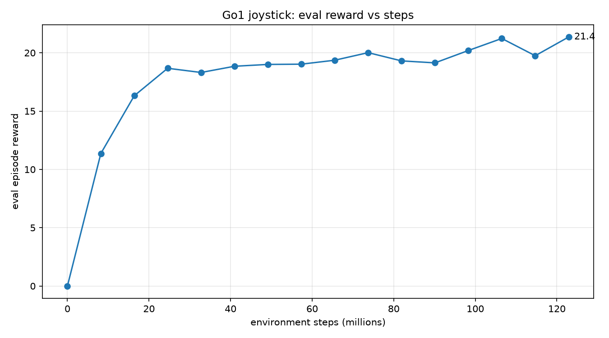

# Test Log 11.1 — Test 11 with the reset interval raised from 200 to 1000 steps (122.88M steps)

**Date:** 2026-11-13 (training 14:32 to 14:58, rollouts and plots to 15:05, videos to 15:24)
**Result:** No gain, and a worse one. The policy **stands still from the first step** and never walks: it moves 0.05 m in 65 s, `track` 0.0001 (the standing value at command 1.5), no fall. The Test 11 policy at least walked the flat part and climbed the 15° ramp. One seed, one rollout per ground.

**Purpose:** [Test 11](../Test11/Test11.md) trained with the 15° ramp 2 m from the start, but every training robot was reset to the start every 200 steps (4 s), too soon to get far up the ramp. Here only that interval changes: `Scripts/train_terrain.py --resets 2`, so all robots are reset every 1000 steps (20 s, the episode cap). Does a longer interval get the policy up the ramp?

## Setup

| Setting | Value |
|---|---|
| Ground (training) | `SlopeRingsGround_2.xml`, the same as Test 11 (d 0 to 2 flat, 2 to 10 at 15°, 10 to 20 flat, 20 to 27 at 25°, 27 to 37 flat, 37 to 42 at 35°) |
| Task | `rough_custom` (the ground loaded by `Scripts/train_terrain.py`), feet-only robot, PPO settings of `Go1JoystickRoughTerrain`, stock domain randomization (as Test 11) |
| `num_timesteps` / `num_evals` / `num_envs` | 120,000,000 / 16 / 4096 |
| **Steps actually run** | **122,880,000** (15 epochs of 8,192,000) |
| `num_resets_per_eval` | **2** (Test 11: the default, 10) |
| **Reset every** | **1000 steps** (computed by the script from the Brax formula and printed in [train.log](./train.log): "forced reset of all robots every 1000 steps (computed)"; Test 11: 200) |
| Episode cap | 1000 steps (20 s), unchanged |
| Seed | 0 |
| Hardware | NVIDIA GeForce RTX 5060 Laptop (8 GB), WSL2 Ubuntu 24.04. Peak GPU memory 4,578 MiB, no crash |
| Run | [run_test11_1.sh](./run_test11_1.sh), training in `~/go1_long`, log [train.log](./train.log), GPU log [gpu.log](./gpu.log). Videos: [render_test11_1.sh](./render_test11_1.sh), a separate script because the videos were asked for after the run had started |
| Policy | `~/go1_long/go1_final` in WSL; a local copy is in `policy/`, which is git-ignored (weights stay out of git) |
| Rollouts | command **1.5 / 0 / 0**, 65 s (3,250 steps), start in the middle, `PRNGKey(0)`, `Scripts/rollout_terrain.py`. New ground (`near/`, with videos) and old `SlopeRingsGround_1` (`orig/`, numbers only) |

## Timings

| Stage | Time |
|---|---|
| Compile (JIT) | 0:01:08 |
| Training | 0:25:07 |

## Reward (evaluation on the new ground)

| Steps | 8.2M | 24.6M | 49.2M | 65.5M | 73.7M | 98.3M | 122.9M |
|---|---|---|---|---|---|---|---|
| Test 11.1 (1000-step interval) | 11.36 | 18.67 | 19.00 | 19.36 | 20.01 | 20.20 | **21.35** |
| Test 11 (200-step interval) | 10.86 | 19.51 | 19.17 | 19.47 | 18.84 | 17.72 | 19.43 |

The reward sits at 18.3 to 21.4 from 24.6M steps on, a little above Test 11 at the end and nowhere near the 26 to 27 of the flat walkers (Test 7). It is measured on the ramp ground, so it is not a score to compare with other rows. The rollout says what the policy does.

## Rollout numbers (command 1.5 / 0 / 0, 65 s)

| | New ground | Old ground |
|---|---|---|
| Fell (episode terminated) | no | no |
| Mean `track` | 0.0001 | 0.0001 |
| Mean `linvel` (body frame) | -0.00003, -0.0008, -0.0007 | -0.00002, -0.0008, -0.0007 |
| Distance from start in 65 s | 0.05 m | 0.05 m |
| Body height, min / mean / max | 0.304 / 0.306 / 0.357 m | 0.304 / 0.306 / 0.357 m |
| Upright (1 = level), min / end | 0.998 / 1.000 | 0.998 / 1.000 |

The two columns match because the robot never leaves the flat middle, so the ground it stands on is the same in both.

`track` of 0.0001 is the value of standing at this command: `exp(-1.5² / 0.25)` is about 0.0001 (at command 1.0 the standing value is 0.018, as in [Test 1.1](../Test1.1/Test1.1.md)). Body height 0.30 m matches the standing height in Test 1.1 (0.29 to 0.32 m).

Files: [reward_plot.png](./reward_plot.png), motion graph, trail map and `track_steps.png` in [near/](./near/) and [orig/](./orig/), videos `top`, `side`, `track` in [near/](./near/) (65 s each, checked with ffprobe for length), `rollout_out.txt`. **I did not watch the videos.** The statement that it stands still rests on the numbers above. Each render printed an EGL clean-up error at the end (`TypeError: 'NoneType' object is not callable` in `mujoco/egl`); the three files are complete.

## Takeaways

- **Raising the interval to 1000 steps did not get the policy up the ramp. In this run it stopped it learning to walk.** The policy never moves, so the ramp is never reached and the Test 11 stall is not touched.
- **This fits [Test 9.2](../Test9.2/Test9.2.md) only partly.** There, intervals of 80, 120 and 200 steps walked (flat ground) and 40 stood. 1000 stands. So walking does not hold for every long interval, and the edge between 200 and 1000 is not known. Why either edge exists is untested.
- **It does not test the "training episodes were too short to reach the ramp" idea** from Test 11, because the policy never walks, so no episode gets near the ramp either. That question is still open.
- **The reward reads like the standing level** (18.3 to 21.4), as in Tests 1 to 4 and 6, but I have not recomputed the reward terms of the standing pose.

## Caveats

- One seed, one training run, one rollout per ground, one command.
- The reset interval is computed by the script from the Brax formula, not read back from the run.
- The training reward is measured on the ramp ground, so it is not comparable with the flat tests.
- Several things could differ between a walking and a standing run (the interval is the one I changed on purpose); I did not test them separately.
- `Scripts/train_terrain.py --resets`, [run_test11_1.sh](./run_test11_1.sh) and [render_test11_1.sh](./render_test11_1.sh) were written by Claude from my request (see Declaration.md).
