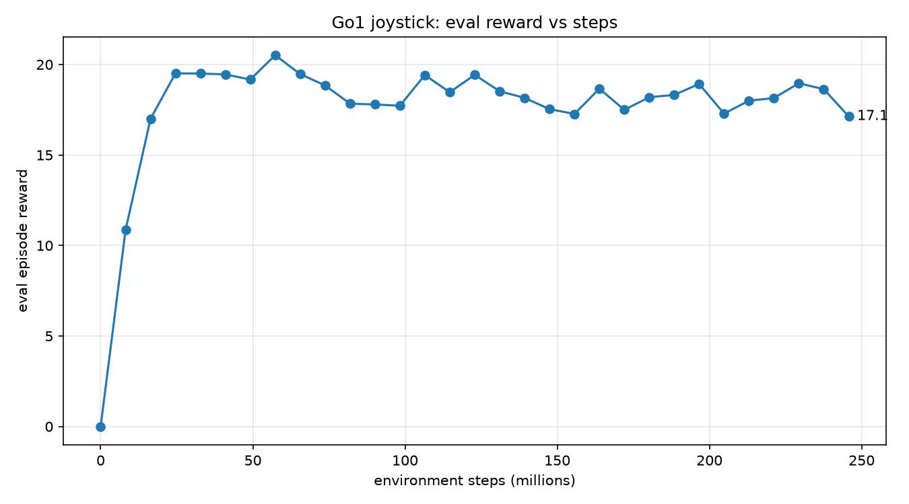

# Test Log 11.2 — The Test 11 policy trained for another 122.88M steps (245.76M in total)

**Date:** 2026-11-13 (training 18:56 to 19:22, rollouts and plots to 19:29, videos to about 19:50)
**Result:** No gain, and a worse stall. After the extra steps the policy walks about 1.2 m/s for 2 s, reaches the foot of the 15° ramp, goes about 0.6 m up it and stops there (new ground at 2.3 s; old ground at 9.0 s, 0.7 m past the foot of its ramp). It then slides slowly back down to the foot over the rest of the 65 s. It never falls. Test 11 (half the steps) got 60% of the way up the ramp. One seed for each part, one rollout per ground.

**Purpose:** Test 11 stalled partway up the 15° ramp. Does more training help? Test 10.5 (254M steps on the old ramp ground) did not, but that policy had probably never met a slope in training (see the Nov 13 entry in [TestingAndFinding.md](../../TestingAndFinding.md)). Here the policy of Test 11, trained with the ramp 2 m from the start, is trained for as many steps again.

## Setup

| Setting | Value |
|---|---|
| Ground (training) | `SlopeRingsGround_2.xml`, the same as Test 11 |
| Starting weights | `~/go1_near/ckpt_122880000`, the last checkpoint of Test 11 (the same weights as its `go1_final`) |
| This part | 122,880,000 steps (16 evaluations = 15 epochs of 8,192,000), 4096 envs |
| **Total steps** | **245,760,000** (122.88M of Test 11 plus this part; Test 10.5: 253.95M) |
| Reset every | 200 steps (the default `num_resets_per_eval` 10, printed by the script: "every 200 steps (computed)"), as Test 11. Episode cap 1000 steps |
| Seed | **1** for this part (Test 11: 0), so the part does not replay the random numbers of the first, as in Test 10.5 part 2 |
| What is restored | the weights only (normalizer, policy network, value network). The optimizer state and the step counter restart, see `train_terrain.py --resume`. So it is not the same as one unbroken 246M run |
| Hardware | NVIDIA GeForce RTX 5060 Laptop (8 GB), WSL2 Ubuntu 24.04. Peak GPU memory 4,576 MiB, no crash |
| Run | [run_test11_2.sh](./run_test11_2.sh), training in `~/go1_near_250m`, logs [train.log](./train.log) (step numbers count from 0), [train_combined.log](./train_combined.log) (Test 11 and this part, steps shifted by 122.88M), [gpu.log](./gpu.log) |
| Policy | `~/go1_near_250m/go1_final` in WSL; a local copy is in `policy/`, git-ignored (weights stay out of git) |
| Rollouts | command **1.5 / 0 / 0**, 65 s (3,250 steps), start in the middle, `PRNGKey(0)`, `Scripts/rollout_terrain.py`. New ground (`near/`, with videos) and old `SlopeRingsGround_1` (`orig/`, numbers only) |

## Timings

| Stage | Time |
|---|---|
| Compile (JIT) | 0:00:59 |
| Training (this part) | 0:24:39 |

## Reward (evaluation on the new ground)

| Total steps | 8.2M | 24.6M | 57.3M | 98.3M | 122.9M | 147.5M | 196.6M | 245.8M |
|---|---|---|---|---|---|---|---|---|
| Reward | 10.86 | 19.51 | 20.52 | 17.72 | 19.43 | 17.53 | 18.92 | **17.13** |

The first five columns are Test 11; the last three are this part. From 24.6M steps on the reward stays between 17.1 and 20.5 and does not climb. In this part alone it is 17.1 to 19.0, with the final value the lowest of the part. The curve is measured on the ramp ground, so it is not a score to compare with the flat tests. The first evaluation of the part (17.84, before any training in it) is below Test 11's last value (19.43): evaluation of a stochastic policy on 1000-step episodes is noisy, and I do not read the difference.

## Rollout numbers (command 1.5 / 0 / 0, 65 s)

| | New ground (ramp from 2 m) | Old ground (ramp from 10 m) |
|---|---|---|
| Fell (episode terminated) | no | no |
| Reached the foot of the 15° ramp | 1.6 s | 8.2 s |
| Forward speed until it stopped (0.5 s to the stop) | 1.24 m/s | 1.38 m/s |
| Last step with `track` above 0.01 | 2.3 s | 9.0 s |
| Ring distance from the centre when it stopped | 2.61 m (0.61 m past the foot, 8% of the 8 m band) | 10.70 m (0.70 m past the foot, 9%) |
| Body height when it stopped | 0.45 m | 0.48 m |
| Forward speed after it stopped | about -0.008 m/s | about -0.010 m/s |
| Ring distance at 65 s | 1.99 m (slid back to the foot) | 10.05 m (slid back to the foot) |
| Mean `track` over 65 s | 0.0216 | 0.1205 |
| Upright (1 = level), minimum | 0.995 | 0.994 |

The "ring distance" here is `max(|x|, |y|)` of the saved position from the ground centre. The rollout starts about 0.5 m off the centre (the reset adds up to 0.5 m), and Test 11.md's ring figures are about 0.5 m smaller than this method gives, so I reran Test 11 with the same method to compare:

| | Test 11 (122.88M) | **Test 11.2** (245.76M) |
|---|---|---|
| New ground, stopped at | 7.27 m, 5.27 m past the foot (66%), body height 1.71 m | 2.61 m, 0.61 m past the foot (8%), 0.45 m |
| Old ground, stopped at | 12.29 m, 2.29 m past the foot (29%), 0.91 m | 10.70 m, 0.70 m past the foot (9%), 0.48 m |

Body height is an independent check: a 15° slope raises the body by about 0.27 m per metre, so 0.1 to 0.15 m above the standing height of 0.30 m means about half a metre up the ramp, the foot of it.

Files: [reward_plot.png](./reward_plot.png), motion graph, trail map and `track_steps.png` in [near/](./near/) and [orig/](./orig/), videos `top`, `side`, `track` in [near/](./near/) (65 s each, length checked with ffprobe), `rollout_out.txt`. **I did not watch the videos.** The statements rest on the saved numbers and the motion graph.

## Takeaways

- **Doubling the training steps did not help; the stall moved from 60% of the way up the 15° ramp (Test 11) to the first metre of it.** The reward stayed at the standing-like level of 17 to 19 for the whole extra part. Same message as Test 10.5: more steps on this ground do not get the policy up.
- **The policy stops within about 0.7 s of reaching the ramp, then slides back down to its foot** (ring distance at 65 s: 1.99 and 10.05 m, the feet of the ramps). Stops are in about the same place relative to the ramp on both grounds (8% and 9% of the band). That fits the policy reacting to the ramp itself and not to the start point or a clock, but it is one run on each ground, so I do not read more into it.
- **Not an effect of steps alone.** The second part used seed 1 and restarted the optimizer, and one seed each means the difference from Test 11 could be run-to-run spread. The Test 11 stop point (60%) and this one (8%) may also move between seeds.
- **It does not explain why it stops.** The hypotheses are unchanged and untested: a poor local optimum (the standing state of Tests 1 to 4), a policy that finds standing safer than moving on a slope, and exposure. The exposure idea is not settled by this test either (the interval was still 200 steps, so episodes were still cut at 4 s).

## Caveats

- One seed per part, one training chain, one rollout per ground, one command.
- The 200-step interval is computed by the script from the Brax formula, not read back from the run.
- The training reward is measured on the ramp ground, so it is not comparable with the flat tests.
- A resumed run restores only the weights, so this is not one unbroken 246M run.
- `Tests/Test11.2/run_test11_2.sh` was written by Claude from my request (see Declaration.md).
