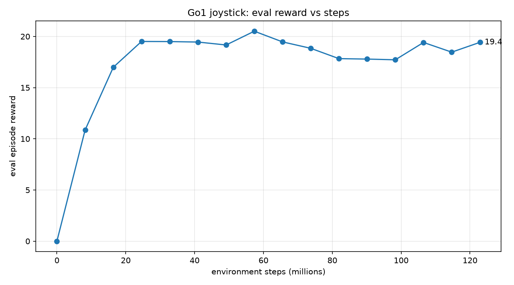

# Test Log 11 — Trained with the 15° ramp 2 m from the start (122.88M steps, standard settings)

**Date:** 2026-11-13 (training 01:10 to 01:36, rollouts and videos done at 02:03)
**Result:** No gain, and a new failure. The policy walks the flat part (1.0 to 1.3 m/s), climbs the 15° ramp at about 1.1 m/s, then **freezes on the ramp** (`track` drops to 0 and stays there) and creeps back about 0.015 m/s for the rest of the 65 s. It never falls and never reaches the 25° ramp. The same freeze happens on the old ground. One seed, one rollout per ground.

**Purpose:** Tests 10.3 to 10.5 were "trained on the ramp ground", but the training robots are reset to the start every 200 steps (4 s) and cover only about 4.4 m in that time, short of the 15° ramp at 10 m (see the Nov 13 entry in [TestingAndFinding.md](../../TestingAndFinding.md); inference, not measured). Here the whole ground is moved 8 m closer, so the 15° ramp starts 2 m from the start point and training episodes meet it within the first seconds. Everything else is as Test 10.3 (the Test 7 settings). Does that get the policy up the 25° ramp?

## Setup

| Setting | Value |
|---|---|
| Ground (training) | `SlopeRingsGround_2.xml`: every band of `SlopeRingsGround_1` moved 8 m closer. d 0 to 2 flat, 2 to 10 at 15°, 10 to 20 flat, 20 to 27 at 25°, 27 to 37 flat, 37 to 42 at 35°. Made with `python Scripts/make_terrain.py --near` (the old ground files are untouched) |
| Task | `rough_custom` (the ground loaded by `Scripts/train_terrain.py`), feet-only robot, PPO settings of `Go1JoystickRoughTerrain`, stock domain randomization (as Test 10.3) |
| `num_timesteps` / `num_evals` / `num_envs` | 120,000,000 / 16 / 4096 |
| **Steps actually run** | **122,880,000** (15 epochs of 8,192,000) |
| Reset every | 200 steps (computed, as Test 7 and 10.3) |
| Seed | 0 |
| Hardware | NVIDIA GeForce RTX 5060 Laptop (8 GB), WSL2 Ubuntu 24.04. Peak GPU memory 4,576 MiB, no crash |
| Run | [run_test11.sh](./run_test11.sh), training in `~/go1_near`, log [train.log](./train.log), GPU log [gpu.log](./gpu.log) |
| Policy | [policy/go1_final](./policy/go1_final) (about 1.7 MB, the weights; the repo rule is to keep weights out of git, so this file is a local copy that should not be committed. The original is `~/go1_near/go1_final` in WSL) |
| Rollouts | command **1.5 / 0 / 0**, 65 s (3,250 steps), start in the middle, `PRNGKey(0)`, `Scripts/rollout_terrain.py`. Run on the new ground (`near/`, with videos) and on the old `SlopeRingsGround_1` (`orig/`, numbers only), so it can be compared with Tests 10.4 and 10.5 |

## Timings

| Stage | Time |
|---|---|
| Compile (JIT) | 0:00:59 |
| Training | 0:24:32 |

## Reward (evaluation on the new ground)

| Steps | 8.2M | 24.6M | 49.2M | 65.5M | 73.7M | 98.3M | 122.9M |
|---|---|---|---|---|---|---|---|
| Test 11 | 10.86 | 19.51 | 19.17 | 19.47 | 18.84 | 17.72 | **19.43** |
| Test 10.3 (old ramp ground) | | 19.49 | 19.31 | 20.57 | 22.21 | 24.29 | 25.74 |
| Test 7 (flat) | | 19.28 | 19.19 | 22.41 | 24.41 | 26.70 | 26.94 |

The reward stays between 17.7 and 20.5 from 24.6M steps on and never climbs the way the other two do after about 55M. It is measured on a different ground (here the ramp is in the first seconds of every evaluation episode), so it is not a score to compare with the other rows. The rollouts below say what the policy does.

## Rollout numbers (command 1.5 / 0 / 0, 65 s)

| | New ground (ramp from 2 m) | Old ground (ramp from 10 m) |
|---|---|---|
| Fell (episode terminated) | **no** | **no** |
| Mean `track` over 65 s | 0.068 | 0.159 |
| Reached the foot of the 15° ramp | 2.4 s | 10.8 s |
| Forward speed on the flat / up to the ramp foot | 1.02 m/s | 1.32 m/s |
| Forward speed on the 15° ramp until it stopped | **1.09 m/s** | **1.05 m/s** |
| Last step with `track` above 0.01 | 8.4 s, d = 6.80 m (4.8 m up the ramp) | 12.9 s, d = 11.82 m (1.8 m up the ramp) |
| Highest ring distance | 6.82 m | 11.83 m |
| Ring distance at 65 s (slid back) | 5.85 m (0.98 m) | 11.13 m (0.70 m) |
| Forward speed after it stopped | about -0.015 m/s | about -0.013 m/s |
| Upright (1 = level), minimum | 0.982 | 0.983 |

On the new ground the `track` per step rises to about 0.93 within 1.3 s, falls to about 0.45, recovers to about 0.68 on the ramp and drops to 0 at 8.8 s ([track_steps.png](./near/track_steps.png)). After that the plot is flat at 0 for the remaining 56 s.

| | Test 10.4 (old ground, 122.88M) | Test 10.5 (old ground, 253.95M) | **Test 11** (old ground) |
|---|---|---|---|
| Fell | step 1316 (26.3 s) | step 1655 (33.1 s) | no |
| Time on the 15° ramp | 10.0 s | 17.1 s | froze 1.8 m up, 12.9 s |
| Forward speed on the 15° ramp | 0.86 m/s | 0.59 m/s | 1.05 m/s until it froze |
| Distance from start (end) | 28.41 m | 30.62 m | 15.66 m |
| Reached the 25° ramp | 25.0 s | 32.4 s | never |

Files: motion graph and trail map in [near/](./near/) and [orig/](./orig/), videos `top`, `side`, `track` in [near/](./near/) (new ground only), reward plot and run script in this folder. `rollout_out.txt` holds the printed numbers.

## What I checked in the videos

I read the `track` reward plot and looked at two frames of the `track` video (at 9 s and 30 s). Both show the robot standing upright on the slope in the same pose, which fits the numbers (no fall, speed near 0). I did not watch the whole video, and I did not watch `top` or `side`.

**The stop, 7.0 to 8.5 s** ([frames_track_7.0_to_8.5s.png](./near/frames_track_7.0_to_8.5s.png), six `track` frames 0.3 s apart, 480 px wide, left to right and top to bottom). The robot is upright in all six (upright 0.987 to 0.995), the legs are in a normal stance, and I could not see a stumble, slip or fall. The numbers at the same times: forward speed 1.12, 1.10, 1.05, 1.00, 0.84, 0.23 m/s, and the body height keeps rising (1.39 to 1.72 m), so it is still climbing as it slows. In 0.5 s bins the speed is 1.04 (7.0 s), 1.00 (7.5 s), 0.76 (8.0 s) and -0.15 m/s (8.5 s), then about 0. So it brings itself to rest over about a second, and no trip triggers it, at the resolution of these frames (a slip shorter than 0.3 s would not show). After 10 s the joints barely move (mean joint speed 0.04 rad/s against about 2.5 while walking), so it is frozen, not stepping on the spot.

## Other commands (same policy, new ground, 65 s, no video)

Files in [near/](./near/) (`*_x1.0_*`, `*_x0.85_*`), script [run_test11_cmds.sh](./run_test11_cmds.sh). The same freeze happens at every command.

| Command (x / 0 / 0) | 1.5 | 1.0 | 0.85 |
|---|---|---|---|
| Fell | no | no | no |
| Reached the foot of the ramp (d = 2 m) | 2.4 s | 3.1 s | 3.8 s |
| Stopped moving at | 8.4 s | 11.6 s | 12.6 s |
| Ring distance / body height when it stopped | 6.80 m / 1.71 m | 6.72 m / 1.67 m | 5.76 m / 1.43 m |
| Distance up the ramp when it stopped | 4.8 m | 4.7 m | 3.8 m |
| Highest ring distance, and at 65 s | 6.82 m, 5.85 m | 6.73 m, 5.84 m | 5.78 m, 5.25 m |
| Forward speed in the last 20 s | about -0.015 m/s | -0.015 m/s | -0.009 m/s |
| Mean `track` over 65 s | 0.068 | 0.152 | 0.194 |

"Stopped" is the last step with `track` above 0.01 for 1.5 and the last step where the 0.5 s average forward speed is above 20% of the command for the other two, so the times are not exactly comparable.

- **The stopping time changes with the command (8.4, 11.6, 12.6 s), the distance up the ramp much less (4.8, 4.7, 3.8 m).** So it is not tied to a clock, which the policy does not have anyway. It stops around 6 to 7 m from the start at the two higher commands and a metre earlier at 0.85. The old ground (command 1.5) froze at 11.82 m, only 1.8 m up its ramp, so it is not a fixed distance on the ramp either.
- A lower command does not remove the freeze, so a command that is too hard to follow is not the reason.
- **It stops before the top every time.** The 15° band is 8 m long (ring distance). The robot stopped 4.8 m up (about 60%), 4.7 m (about 59%) and 3.8 m (about 48%) on the new ground at the three commands, and 1.8 m up (about 23%) on the old ground. It never reached the flat plateau after the ramp. The share is "ring distance when it stopped minus where the ramp starts, over 8 m".

## Hypothesis (mine, not tested): it settles into the same "stand still and keep the standing reward" state as Tests 1 to 4

- **Why I think so.** After the stop the robot is upright, the joints barely move (about 0.04 rad/s against 2.5 while walking) and it holds a normal stance, which is what a standing policy does. In Tests 1 to 4 and 6 the robots stood still on flat ground and still scored about 17 to 19 per episode, because the pose term (about 10 of the roughly 40 possible) pays for standing ([TestingAndFinding.md](../../TestingAndFinding.md)). The training reward of this run sits at 17.7 to 20.5 from 24.6M steps on.
- **What does not fit or is missing.** The reward is measured on a different ground, so I cannot read 19 as "standing level" the way I can on flat ground. The rollout does not save the individual reward terms, only `track`, so I have not measured what the frozen robot earns. The freeze starts only after the robot has walked and climbed, so it is not the same as never having learned to walk (on the flat part it tracks the command at 1.0 to 1.3 m/s).
- **Other explanations I cannot rule out (none tested).**
  - *A local optimum, not a glitch.* Standing pays by design (the pose term), so it is not a loophole in the reward, but it scores less than walking on flat ground (about 17 to 19 against 26 to 27 per episode). Stopping also gives up the `track` reward the robot was earning while it climbed, so a stop looks like a worse policy, not a cleverer one. Whether the frozen pose earns more or less per step than the walking did is not known, because the rollout does not save the reward terms. "Reward hacking" would need that comparison before I can say it.
  - *Safe but poor.* A fall ends the episode, so staying still on a slope could look safer to the policy than moving. Not tested.
  - *Exposure.* Training episodes were cut at 200 steps (4 s) and cover about 4.4 m, up to about 6 m at the 1.5 m/s ceiling. The stops at 5.8 to 6.8 m on the new ground are around that edge. The policy has no position sensor, so it cannot know where it is; the point is only that the states it meets late in a long rollout may be ones it never trained on. The old ground froze at 11.8 m, far from that edge, so this cannot be the whole story. What the training robots reached was not logged.
- **How to test it.** (1) Recompute the reward terms of the frozen pose from the Playground reward code, or save them in the rollout, and compare the sum with the per-episode training reward. (2) Run the same training for longer or with another seed, to see whether it leaves the plateau the way the flat runs do after about 55M steps. (3) Start the policy at rest on the slope with a command and see whether it ever moves off.

## Next (planned, not run)

**Test 12:** the same training as this test with one change, a longer reset interval: `Scripts/train_terrain.py --resets 2`, so all robots are reset every 1000 steps (20 s, the episode cap) instead of every 200. The 200-step interval cut training episodes before the robot could get far up the ramp. Script [../Test12/run_test12.sh](../Test12/run_test12.sh). A 1000-step interval has never been run (Test 9.2 covers 40 to 120 only), so it may fail to walk at all. It was started once and stopped after about a minute, so there are no results yet.

## Takeaways

- **Moving the ramp to 2 m did not get the policy up the 25° ramp, because it never got that far.** It freezes on the 15° ramp. Tests 10.2 to 10.5 all crossed the 15° ramp and failed at 25°, so this is a different and earlier failure.
- **It climbs the first part of the 15° ramp faster than the earlier policies** (about 1.1 m/s forward, against 0.86 m/s in Tests 10.2 to 10.4 and 0.59 in 10.5). That is the one hint that training on the ramp changed how it climbs, if the earlier "never saw a slope" inference is right. One seed, so I do not read it as an effect.
- **The freeze point is not the same on the two grounds** (4.8 m up the ramp on the new ground after 8.4 s, 1.8 m up on the old ground after 12.9 s), so I cannot link it to a fixed time or distance. Why it freezes is not known.
- **The training reward stayed near 19 and never rose after 55M steps,** but it is measured on this ground, so the 19 is not a standing-level reading as it is on flat ground. The rollouts, not the reward, show that it walks.
- This test changed only where the ramp is. The reset interval (200 steps), the episode cap and the seed are as in Test 10.3.

## Caveats

- One seed, one training run, one rollout per ground, one command.
- The 200-step reset interval is computed from the formula, not printed by the training script.
- The training reward is on the new ground, so it is not comparable with the other rows.
- What the training robots actually did was not logged. That they met the ramp early follows from the ground layout and the distance a policy covers in 200 steps, not from a measurement.
- `Scripts/make_terrain.py --near` and [run_test11.sh](./run_test11.sh) were written by Claude from my request (to go in Declaration.md).
